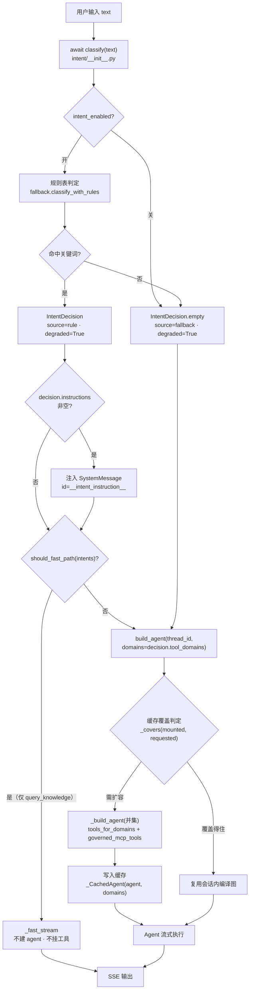
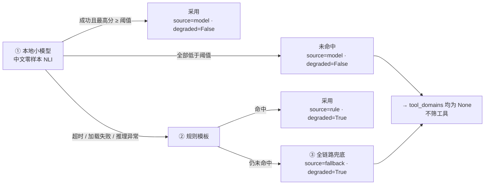
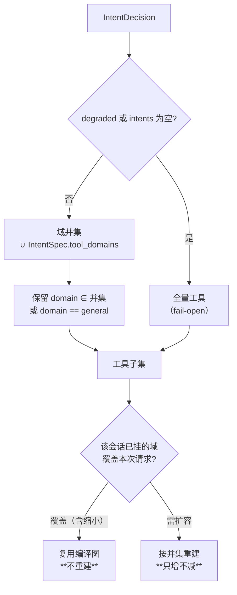

# 设计 — 意图识别 v2

> 📋 **规范**：遵循 `docs/规则/文档规范.md`
> 📌 **更新时间**：2026-10-16（v2.1 补流程图）
> 📝 **版本变更记录**（永久保存，只追加不删除）：
> | 版本 | 日期 | 具体改动 |
> |------|------|---------|
> | v2.1 | 2026-10-16 | **§6.1 新增三张 Mermaid 流程图**（全链路流程 / 判定降级链 / 工具域筛选与缓存只增不减），原 §6.1–§6.3 顺延为 §6.2–§6.4；§1.2 边界表补"内部服务"落点 |
> | v2 | 2026-10-16 | **定稿版**：§3 差异点表回填 D1–D10 拍板结果；**§4 意图体系**（7 意图 → 工具域 + 指令注入绑定表，多意图取域并集）；**§5 判定实现**（本地中文零样本 NLI + 二级降级链）；**§6 消费侧**（工具子集筛选 fail-open / 指令注入）；§7 目录结构；**§8 domain 常量与 MCP 安装校验**；§10 评估方案；§14 待拍板 5 项；§17 核心代码。**移除 A2A**（co-creator 拍板：本服务仅供内部使用，不对外部系统暴露）|
> | v1 | 2026-10-15 | 初版：对照外部草案 v1.0（A2A 独立 Agent + 本地 NLI）做设计意图校准——8 条现状实测 + 10 条差异点总表 + 落点/意图体系/判定实现/输出契约 + 待拍板 D1–D6 |

> 🔗 **上游**：`docs/决策/2026-10-14-设计-工具中心职责边界-v1.md`（登记表范式）｜
> `docs/决策/2026-10-15-设计-工具动态注册两方案对比-v1.md`（"DB 存配置、代码存行为"判据）｜
> `docs/决策/2026-09-14-设计-资料检索与RAG基础系统-v1.md`（§2.1 可选依赖组范式）
> 📌 **实测基线**：本设计 file:line 实测自 `develop` HEAD `10ee331`

> **目录**：
> - §1 定位与范围
> - §2 现状核实（实测）
> - §3 设计决策溯源（v1 差异点 → 拍板结果）
> - §4 意图体系
> - §5 判定实现
> - §6 消费侧（意图怎么被用掉）
> - §7 目录结构
> - §8 domain 常量与工具侧登记
> - §9 异常与边界
> - §10 评估方案
> - §11 目录与依赖影响
> - §12 不做清单
> - §13 风险
> - §14 待拍板决策点 🔴
> - §15 实施批次
> - §16 面试要点
> - §17 完整核心代码
> - §18 关联

---

## 1. 定位与范围 🔴 v2

### 1.1 一句话

在 `用户输入 → 主 Agent` 之间加一个**意图判定环节**：用**本地小模型**把用户请求分到若干个**意图领域项**，判定结果驱动两件事——**挂哪些工具**（按工具域筛选）与**注入哪段指令**。

### 1.2 边界

| ✅ 做 | ❌ 不做 |
|---|---|
| 多标签意图判定（一句可命中多个意图） | 参数提取 / 槽位解析 |
| 判定结果 → 工具子集 + 指令注入 | 工具执行 / 知识库检索 / 任务规划 |
| 二级降级（小模型 → 规则 → 全链路） | **A2A 协议 / 对外暴露**（本服务仅供内部使用） |
| 判定结果可观测（来源 / 降级 / 时延） | 替代主 Agent 的决策（只提供先验，不代替判断） |

---

## 2. 现状核实（2026-10-16 实测，非推测） 🔴 v2

| # | 事实 | 证据 |
|---|---|---|
| 1 | **「意图识别」已存在**——纯规则，只输出 `simple` / `complex` | `backend/src/agent/intent.py:24` `classify_intent`（关键词子串匹配 + 长度<60；兜底 `complex`）；模块 docstring 第 6 行：「兜底原则：**不确定就走完整链路**」 |
| 2 | **消费方也已存在**——快通道旁路 | `backend/src/api/chat.py:672` 调用；快通道 `chat.py:607-632` `_fast_stream`（不建 agent、不挂工具） |
| 3 | **判定位置在 `build_agent()` 之前** | `chat.py:672`（判定）→ `chat.py:681`（`build_agent`，工具在此挂载）——**这是"工具子集筛选"可行的前提** |
| 4 | **工具已有现成的分组键 `domain`** | `backend/src/tools/registry.py` `ToolSpec.domain`，11 个工具分属 `search` / `sandbox` / `file` / `skill` / `wiki` / `report` / `hitl` |
| 5 | **`domain` 当前零消费方** | 工具中心自标注为「人读标签，无消费方」——本设计给它**第一个真实读者** |
| 6 | **零本地推理依赖** | `requirements.txt` / `pyproject.toml` 无 `torch` / `transformers` / `sentence-transformers` |
| 7 | **项目已明确评估过 PyTorch 并主动缓引入** | `docs/决策/2026-09-14-设计-资料检索与RAG基础系统-v1.md` §2.1：「基础依赖**不强制引入 PyTorch**」→ 放可选依赖组 |
| 8 | **已有"轻量辅助判定"的现成范式** | `agent/tasks/assistant.py:21` `generate_title`（单次 LLM 调用）；`config.py` 的 `memory_agent_model`（"抽取专用小模型"配置项）；`agent/prompts/prompts.py:5`（"新增辅助任务先在此加 prompt"） |

---

## 3. 设计决策溯源（v1 差异点 → 拍板结果） 🔴 v2

> v1 对照外部草案 v1.0 列了 10 条差异点（草案主张 A2A 独立 Agent + 本地 NLI + 7 意图 + 固定阈值 0.7 + 不做降级）。
> 下表是**当时的差异分析 + 最终拍板**——保留它是为了让后来者看到"为什么不是草案那样"。

| # | 草案主张 | 差异性质 | ✅ 拍板结果（co-creator） |
|---|---|---|---|
| **D1** | 意图识别做成独立 Agent，经 **A2A 协议**对外提供 | 增量成本：需补协议实现 / 服务发现 / 端口 / 部署单元 | **A2A 整体移除**——"该服务只供内部使用，并不是要对外部系统使用"（2026-10-16）。落点改为**进程内前置函数** |
| **D2** | 7 意图（chat / query_knowledge / tool_call / code_run / task_plan / creative_write / summarize） | 语义：意图与消费方不对齐 | **保留 7 意图**，但**每个意图必须绑定消费动作**（工具域 + 指令注入），见 §4 |
| **D3** | 模型 = 本地 `cross-encoder/nli-MiniLM2-L6-H768` | 依赖：项目零本地推理栈 | **改为本地中文零样本 NLI**（换掉 MiniLM2，它不擅长中文）；走**可选依赖组**，见 §5.1 |
| **D4** | 阈值固定 0.7 | 策略：NLI 分数非校准置信度 | **0.7 起步 + 可配常量 + 记录分数分布**，后期用数据调（2026-10-16） |
| **D5** | 「不做二级降级，异常只返回 error」 | 🔴 **违反规则 06 §4**「不因单点失败断流」 | **做二级降级**：小模型 → 规则模板 → 全链路兜底，见 §5.2 |
| **D6** | 自建 `status` / `error_msg` 字段 | 契约：与项目三态/错误码体系并存 | **以项目为主**（2026-10-16）：复用 `core/errors.py` 口径 |
| **D7** | 超时 5s | 体验：串行压在首 token 上 | **5s 降为硬超时上限**（非预期耗时）；预期预算收紧到百毫秒级，超预算即降级，见 §5.4 |
| **D8** | 自建 A2A payload 信封 | 协议：两套契约 | 随 D1 一并移除 |
| **D9** | 「下游主 Agent 自行处理多意图路由」 | 落点：无实现方的接口 | **定义路由表**——意图 → 工具域 + 指令，见 §4.3 |
| **D10** | 测试 5 例样例 | 口径：样例 ≠ 回归集 | **补评估方案**（混淆矩阵 / 降级率 / bad case），见 §10 |

> **一句话**：草案的三件最大件（A2A / 本地 NLI 全量引入 / 7 意图直接可用）**全部被调整或移除**；
> 留下的核心是「**判定 → 工具子集 + 指令注入**」这条消费链。

---

## 4. 意图体系 🔴 v2

### 4.1 意图 → 消费动作绑定表（**唯一真相源**）

**原则**：先有下游，才有意图。一个意图若拿不到任何代码分叉，它就是标签而非路由。

| 意图 ID | 工具域（筛选） | 指令注入 | 下游状态 |
|---|---|---|---|
| `chat` 闲聊 | `{}` 不挂工具 | 闲聊指令 | ✅ 可落 |
| `query_knowledge` 知识问答 | `{}`（RAG 未实现） | 知识问答指令 | ⚠️ 弱——见 §14-Q2 |
| `tool_call` 工具调用 | `{search}` | — | ✅ 可落 |
| `code_run` 代码执行 | `{sandbox}` | — | ✅ 可落 |
| `task_plan` 任务规划 | `{}` | 规划指令 | ⚠️ 弱——与框架自带 planning 重叠，见 §14-Q2 |
| `creative_write` 创意生成 | `{}` | 创作指令 | ✅ 可落 |
| `summarize` 文本摘要 | `{file}` | 摘要指令 | ✅ 可落 |
| （兜底）`unknown` | **全量** | — | 见 §6.3 fail-open |

**域并集规则**：多意图命中时取**域并集**。
例：`"帮我查今天气温，再写段 matplotlib 代码"` → `[tool_call, code_run]` → 域 `{search} ∪ {sandbox}` = `{search, sandbox}`。

> 📌 这正是草案"多标签"设计的**正当用法**——草案里多标签没有消费方，这里有了。

### 4.2 与工具域对齐

意图名**优先复用工具域词汇**（`search` / `sandbox` / `file` / `skill` / `wiki` / `report` / `hitl`），避免"工具域"与"意图域"两套词各自演化。

### 4.3 单一登记处

```python
# backend/src/intent/registry.py —— 意图的**唯一登记处**
@dataclass(frozen=True)
class IntentSpec:
    name: str
    description: str                      # 给判定器看的语义描述
    tool_domains: frozenset[str]          # 该意图保留的工具域（空 = 不挂工具）
    instruction: str                      # 注入的指令片段（空 = 不注入）
    examples: tuple[str, ...] = ()        # 回归样例（测试从此派生，禁止另抄一份）
```

消费方全部派生，**禁止**在 `chat.py` / 测试文件里再写一份意图字面量——同 `TOOL_REGISTRY` 的纪律（规则 07 §1）。

---

## 5. 判定实现 🔴 v2

### 5.1 模型选型

| 项 | 值 |
|---|---|
| **形态** | **本地部署**（co-creator 拍板：必须本地化可部署，用小模型替代远程 LLM 做简单意图识别） |
| **方法** | 中文**零样本 NLI**（借"文本 ⊨ 意图描述"的蕴含概率做分类，免标注） |
| **候选** ⚠️ | 110M 档（如 `IDEA-CCNL/Erlangshen-Roberta-110M-NLI`）；备选多语种 `MoritzLaurer/mDeBERTa-v3-base-mnli-xnli`（278M，更重） |
| **内存** 📊 | 110M + torch CPU ≈ **700MB~1GB**（估算）；278M ≈ 1.4GB |
| **依赖** | `transformers` + `torch`，**放可选依赖组**（沿用 RAG 设计 §2.1 范式），关闭时应用照常启动 |

> ⚠️ **选型未实测**：以上为候选非定论。落地前需做**离线对比实验**（§15 批次 4）：
> 用真实样本比准确率 / 内存 / 时延，再定用哪个模型、是否 int8 量化。
> **注意**：`nli-MiniLM2-L6-H768`（草案原选）是**英文** NLI 模型，中文零样本效果存疑——故换掉。

**关于"训练"的演进路径**（面试可讲）：零样本 NLI 是**不训练**的第一步；目标形态是
**用远程 LLM 造标注 → 蒸馏一个更小的分类模型**（更快 / 更准 / 更小）。这是"大模型蒸馏小模型"的标准生产做法。

### 5.2 降级链（🔴 对应 D5，规则 06 §4「不因单点失败断流」）

```
① 本地小模型判定
   ├─ 成功且最高分 ≥ 阈值 → 采用
   └─ 超时 / 加载失败 / 推理异常 / 全部低于阈值
        ↓
② 规则模板判定（复用现有 intent.py 关键词表）
   ├─ 命中 → 采用
   └─ 仍不确定
        ↓
③ 全链路兜底（intent = unknown）
   → 不筛工具（全量挂载），不注入指令，走完整 Agent 链路
```

**三档都要落 `source` 字段**（`model` / `rule` / `fallback`）——降级率是可观测指标（§10）。

### 5.3 阈值

`0.7` 起步，写成**可配常量**（`settings.intent_threshold`）。落地后记录判定分数分布，用数据调整——**不在没有数据时争论阈值**。

### 5.4 时序预算

| 项 | 值 |
|---|---|
| 预期耗时 | 本地 110M 模型 CPU 单次 ≈ 数十毫秒 📊 |
| 预算 | **≤300ms**，超预算即降级（不阻塞主链路） |
| 硬超时上限 | 5s（草案值保留为**兜底**，非预期） |
| 位置 | **保持在 `chat.py:672`（`build_agent()` 之前）**——上移到 `start` 事件之前只会让用户更晚看到反馈 |

---

## 6. 消费侧：意图怎么被用掉 🔴 v2

### 6.1 全链路流程（先看这三张图） 🟠 v2.1

#### 图 1｜端到端流程



#### 图 2｜判定降级链（**绝不抛异常**）



> ⚠️ 图 2 第 ① 档当前**未接通**（批次 4）；线上现在只跑 ②③。

#### 图 3｜工具域筛选与"只增不减"



### 6.2 工具子集筛选（按 `domain`）

```python
# 伪代码
if decision.degraded or not decision.intents:
    return 全量工具                      # fail-open，见 §6.3
domains = ∪ spec.tool_domains for spec in 命中的意图
return [t for t in 全量工具 if t.domain in domains or t.domain == DOMAIN_GENERAL]
```

**收益与时机**：当前 7 个挂载工具，筛选收益小；**但工具正在变多**——MCP 工具动态注册（`mcp_servers` 表 + 市场安装）已落地，工具数会持续增长，届时"全量挂载导致 context 膨胀 + 选择准确率下降"才会真正显现。**现在做是为了那时**。

### 6.3 指令注入

项目**已有现成范式**：`req.mode` → `MODE_INSTRUCTIONS` 注入 SystemMessage（`chat.py:284-290`，`prompts.py:85-100`）。意图指令走同一条路，改动极小。

### 6.4 fail-open 语义（🔴 重要设计判断）

```
安全元数据（requires_approval） → fail-closed：未登记默认拒绝
路由元数据（domain / 意图）      → fail-open ：非法 / 未命中 → 回退"全量"
```

**方向相反是对的**：安全声明猜错的代价是"高危工具绕过审批"（必须往严里兜）；路由声明猜错的代价只是"工具没被筛掉，多占点 token"（往宽里兜才对）。**判错意图不能弄坏功能**——这是本设计的第一原则。

---

## 7. 目录结构 🔴 v2

```
backend/src/intent/                  ← 独立能力域（与 tools/ wiki/ sandbox/ 并列）
├── __init__.py                      ← 对外只暴露 classify() / 数据结构
├── registry.py                      ← 意图登记表（唯一真相源，§4.3）
├── classifier.py                    ← 本地小模型判定（NLI）
├── fallback.py                      ← 规则模板降级（承接现有 intent.py 的关键词表）
├── decision.py                      ← IntentDecision 数据结构
└── prompts.py                       ← 意图描述文本（NLI 假设句 + 指令片段）
```

**动作**：现有 `backend/src/agent/intent.py` 的规则逻辑**搬进 `fallback.py`**，原文件删除。

> ⚠️ **分层待确认（§14-Q1）**：`api/chat.py` 现直接 import `src.agent.intent`（agent 层）。
> 若 `intent/` 上提为顶层能力域，`chat.py` 直调即构成 `api → 能力域`，规则 06 §2 的「禁跨多层跳跃」是否覆盖此情形需要拍。

---

## 8. domain 常量与工具侧登记 🔴 v2

### 8.1 常量集中（co-creator 2026-10-16 拍板）

放 **`core/constants.py`**，不新建 `domain/const.py`——依据 `06-structure-optimization.md` §3「跨文件共用 → core/constants.py（用两次就抽）」。新建独立常量文件等于开第二个常量家。

```python
# backend/src/core/constants.py
DOMAIN_SEARCH = "search"
DOMAIN_SANDBOX = "sandbox"
DOMAIN_FILE = "file"
DOMAIN_SKILL = "skill"
DOMAIN_WIKI = "wiki"
DOMAIN_REPORT = "report"
DOMAIN_HITL = "hitl"
DOMAIN_GENERAL = "general"          # 兜底域，见 §8.2

Domain = Literal["search", "sandbox", "file", "skill", "wiki", "report", "hitl", "general"]
```

> 顺带修一处：`ToolSpec.domain` 现标注为裸 `str`，而工具中心规范 §2.2 明写「**能枚举就绝不裸 str**」——收成 `Domain`。

### 8.2 工具侧登记（两层各自声明，意图表不动）

```
第一层：意图 → 域集合      ← intent/registry.py（7 行，稳定）
第二层：工具 → 域          ← 各自在自己的登记处声明
        代码工具 → tools/registry.py 的 ToolSpec.domain      ✅ 已有
        MCP 工具 → mcp_tool_meta 表                          ⚠️ 缺一列，要补
```

**新装一个工具时只改第二层，意图表一个字不动。**

**MCP 安装时的 domain 校验**（co-creator 2026-10-16 拍板）：

| 项 | 决定 |
|---|---|
| 自动识别 | ❌ **不做关键词猜测**（猜错比不猜更糟——工具会被塞进错误的域，反而弄坏功能） |
| 默认值 | ✅ 默认 `general`，等人工修正 |
| 非法值 | ✅ 强制回退 `general` |

落点：`mcp_tool_meta` 补 `domain TEXT NOT NULL DEFAULT 'general'` 列 + `tools/market/installer.py` 写入时校验。

---

## 9. 异常与边界 🔴 v2

| 场景 | 处理 |
|---|---|
| 空输入 | `intents=()`, `source="fallback"`, `degraded=True` → 全链路 |
| 模型加载失败（启动期） | 整体降级到规则模板，**服务照常启动**（不因模型问题拒绝服务） |
| 推理超时 | 立即降级到规则（不等满预算） |
| 全部分数 < 阈值 | `intents=()`, `source="model"`（模型正常跑完，只是没命中）——**与"模型故障"区分** |
| 判定为空但未降级 | 同 `unknown`，走全量工具 |
| 多意图 | 取域并集，指令按登记表顺序拼接 |

> 📌 草案原设计区分"业务 unknown / 系统 error"两类。本项目保留这个**区分**（用 `source` 字段表达），但不自建 `status` / `error_msg` —— 契约以项目为主（D6）。

---

## 10. 评估方案 🔴 v2

> 对应面试指南 **P0 评估体系**——这是本功能最能撑起面试的部分。

| 项 | 方案 |
|---|---|
| **样本集** | LLM 生成起步（零人工标注成本）→ 人工抽检修正；每个意图 ≥ 20 条（含边界与反例） |
| **指标** | ① 整体准确率 ② 各意图 P / R ③ **混淆矩阵**（看哪两个意图最容易混）④ **降级率**（`source != model` 占比）⑤ 时延 P50 / P95 |
| **bad case 归因** | 分三类：描述文本歧义 / 阈值不当 / 模型能力不足——分别对应"改意图描述 / 调阈值 / 换模型" |
| **回归** | `IntentSpec.examples` 派生用例（见 §17.4），改登记表即改测试 |
| **落地后要补的数** | 快通道命中率、误判率、首 token 延迟变化、降级率、筛选后 context token 节省比 |

---

## 11. 目录与依赖影响 🔴 v2

| 动作 | 路径 | 说明 |
|---|---|---|
| 新增 | `backend/src/intent/` | 意图能力域（§7） |
| 删除 | `backend/src/agent/intent.py` | 规则逻辑搬入 `intent/fallback.py` |
| 改 | `backend/src/api/chat.py:672` | 消费点：改用 `IntentDecision` + 工具筛选 + 指令注入 |
| 改 | `backend/src/agent/main_agent.py` | 工具挂载：接受"按意图筛过的工具集" |
| 改 | `backend/src/core/constants.py` | 新增 `DOMAIN_*` + `Domain` |
| 改 | `backend/src/tools/registry.py` | `ToolSpec.domain` 由 `str` 收成 `Domain` |
| 改 | `backend/src/db/schema.py` | `mcp_tool_meta` 补 `domain` 列 |
| 改 | `backend/src/tools/market/installer.py` | 安装时校验 domain，非法 → `general` |
| 改 | `backend/src/core/config.py` | `intent_enabled` / `intent_threshold` / `intent_timeout_ms` / `intent_model_path` |
| 改 | `pyproject.toml` | 可选依赖组（`transformers` + `torch`） |
| 新增测试 | `backend/tests/test_intent/` | 判定 / 降级 / 登记表自洽 / 工具筛选 |

**零新增部署单元**——全部在现有单进程单端口内（A2A 移除后）。

---

## 12. 不做清单 🔴 v2

| 不做 | 原因 |
|---|---|
| **A2A 协议 / 对外暴露** | co-creator 2026-10-16：本服务仅供内部使用，不对外部系统 |
| 参数提取 / 槽位解析 / 工具执行 / 任务规划 | 归属下游主 Agent（草案 §6 亦如此划界） |
| 在检索链路做意图路由 | `2026-09-14-设计-资料检索与RAG基础系统-v1.md` §5.1 已明确否定 |
| 关键词猜测 MCP 工具的 domain | 猜错比不猜更糟（§8.2） |
| GPU 推理 / ONNX 导出 | 2核4G 无 GPU；CPU 单次数十毫秒已够 |
| 新增 SSE 事件类型 | 协议固定 8 类（`schemas/events.py`）；判定结果不进前端协议 |
| 首版训练分类器 | 零样本 NLI 先拿基线；蒸馏是演进档（§5.1） |

---

## 13. 风险 🔴 v2

| # | 风险 | 处置 |
|---|---|---|
| R1 | **误判导致工具被筛掉**，功能不可用 | fail-open：低置信 / 降级 / `general` 域**始终保留**；判错只损失 token，不损失能力（§6.3） |
| R2 | **判定失败断流** | 二级降级链 + 硬超时（§5.2、§9） |
| R3 | **模型选型未实测**（中文零样本效果未知） | 批次 4 离线对比实验，**不达标不上线** |
| R4 | **依赖体积 / 内存超限** | 可选依赖组（关闭时应用照常启动）+ 必要时 int8 量化 |
| R5 | **判定延迟吃掉快通道收益** | 预算 ≤300ms + 超预算即降级（§5.4） |
| R6 | **意图表与消费方脱节复发** | 单一登记处 + 样例从表派生 + 登记表自洽性测试（§17.4） |

---

## 14. 待拍板决策点 🔴 v2

| # | 决策 | 选项 | 我的建议 |
|---|---|---|---|
| **Q1** | **目录落点 / 分层** | (a) `backend/src/intent/` 顶层能力域（已按此设计）｜(b) `backend/src/agent/intent/` 子包 | (a)——它含"LLM 细节 / 格式解析"，按规则 06 属能力层；但 `chat.py` 直调构成 `api → 能力域`，**需确认这条是否算跨层** |
| **Q2** | **两个弱意图怎么办** | (a) 保留（先只注入指令）｜(b) 暂缓，先做 5 个 | (a) 保留——`query_knowledge` 等 RAG 落地后自然变强；`task_plan` 与框架 planning 重叠，可先只注入不筛工具 |
| **Q3** | **评估样本来源** | (a) LLM 生成｜(b) 人工标注｜(c) 混合 | (c)——LLM 生成打底（省成本）+ 人工抽检（保质量） |
| **Q4** | **本地模型内存方案** | (a) 调高容器限额｜(b) int8 量化｜(c) 两者都做 | (b) 优先——量化把 110M 压到 ~110MB，不动限额最省事 |
| **Q5** | **首次上线开关默认值** | (a) 默认开｜(b) 默认关，手动开 | (b)——判定没数据前先默认关，可观测对比，验证后再默认开 |

---

## 15. 实施批次 🔴 v2

```
批次 1｜骨架：intent/ 目录 + registry.py（7 意图登记表）+ decision.py + 规则降级
        ← 纯新增，行为等价于现有规则判定，零风险
批次 2｜常量与工具侧：core/constants.py 的 DOMAIN_* + ToolSpec.domain 收枚举
                     + mcp_tool_meta 补 domain 列 + 安装校验
        ← 只加不删，已有工具补默认域 general
批次 3｜消费侧接线：工具子集筛选（fail-open）+ 指令注入 + 降级来源日志
        ← ⚠️ 行为敏感，需保证"判错不弄坏功能"
批次 4｜本地模型：引入可选依赖 + 离线对比实验（模型 / 量化 / 阈值标定）→ 达标才接线
批次 5｜评估：样本集 + 混淆矩阵 + 降级率 + bad case 分析
```

每批次一个提交，可独立回滚。

---

## 16. 面试要点（对照备战指南 §3.2 / §3.3） 🔴 v2

| 项 | 内容 |
|---|---|
| **覆盖模块** | **评估体系（P0）**：混淆矩阵 + 降级率 + bad case 归因（§10）｜**成本控制（P1）**：本地小模型替代远程 LLM + 意图筛工具省 context｜**容错（P1）**：二级降级链 + 超预算降级（§5.2）｜HITL / 安全：不覆盖 |
| **架构层追问** | "为什么不做成工具？"→ 判定必须在 `build_agent()` **之前**跑完（它的产物是"挂哪些工具"），做成工具就太晚了。｜"为什么不用远程 LLM？"→ 意图识别是**高频、简单、可蒸馏**的判断，用远程大模型是浪费；本地小模型零 token 成本。 |
| **实现层追问** | "7 个意图怎么定的？"→ **由消费方反推**：每个意图必须绑定工具域 + 指令；没有下游的意图一律不建（与工具中心清算"声明了没人读"同一纪律）。｜"判错了怎么办？"→ fail-open：低置信直接回退全量工具，**判错只损失 token，不损失能力**。 |
| **效果层追问** | 用 §10 的指标回答：准确率 / 混淆矩阵 / 降级率 / 首 token 延迟变化。**bad case 分三类归因**（描述歧义 / 阈值 / 模型能力），各对应一种处置。 |
| **优化层追问** | ① 零样本 NLI → **大模型蒸馏小模型**（数据飞轮）② 阈值用真实分布标定 ③ 工具规模继续涨后可上**语义检索选工具**（tool RAG）替代静态域映射 |
| **可量化指标** | 快通道命中率、误判率、降级率、筛选后 context token 节省比、首 token 延迟变化 |

---

## 17. 完整核心代码 🔴 v2

### 17.1 意图登记表（`backend/src/intent/registry.py`）

```python
"""意图登记表——意图的**唯一真相源**。

消费方（判定器语义描述 / 工具子集筛选 / 指令注入 / 回归样例 / 评估集）
全部从本表派生，禁止在别处再写一份意图字面量。
"""

from __future__ import annotations

from dataclasses import dataclass

from src.core.constants import DOMAIN_FILE, DOMAIN_SEARCH, DOMAIN_SANDBOX


@dataclass(frozen=True)
class IntentSpec:
    """一个意图的声明。

    Attributes:
        name: 意图 ID（与工具域同族词汇，见设计 §4.2）
        description: 语义描述（NLI 假设句 / 规则模板共用）
        tool_domains: 该意图保留的工具域（空 = 不挂工具）
        instruction: 注入 SystemMessage 的指令片段（空 = 不注入）
        examples: 回归样例（测试与评估从此派生）
    """

    name: str
    description: str
    tool_domains: frozenset[str] = frozenset()
    instruction: str = ""
    examples: tuple[str, ...] = ()


INTENT_REGISTRY: dict[str, IntentSpec] = {
    "chat": IntentSpec(
        name="chat",
        description="日常闲聊、问候、感慨，不需要调用工具或检索外部信息",
        instruction="用户在闲聊，直接自然回应，不要调用工具。",
        examples=("你好呀，最近怎么样", "今天心情不错"),
    ),
    "tool_call": IntentSpec(
        name="tool_call",
        description="需要联网搜索、查询实时信息或读写外部资源",
        tool_domains=frozenset({DOMAIN_SEARCH}),
        examples=("帮我查今天的气温", "搜一下最新的 Agent 框架对比"),
    ),
    "code_run": IntentSpec(
        name="code_run",
        description="要求编写、运行或调试代码，执行程序逻辑",
        tool_domains=frozenset({DOMAIN_SANDBOX}),
        examples=("写一段 matplotlib 绘图代码并跑一下", "帮我调试这段 Python"),
    ),
    "summarize": IntentSpec(
        name="summarize",
        description="对已有长文本做总结、提炼核心要点",
        tool_domains=frozenset({DOMAIN_FILE}),
        instruction="用户要的是摘要，输出精炼要点，不要展开无关内容。",
        examples=("帮我总结这篇文档要点",),
    ),
    "query_knowledge": IntentSpec(
        name="query_knowledge",
        description="询问事实、概念、原理，需要准确的知识性回答",
        instruction="这是知识问答，回答要准确；不确定就明说，不要编造。",
        examples=("什么是 ReAct 循环", "解释一下向量检索的原理"),
    ),
    "task_plan": IntentSpec(
        name="task_plan",
        description="需要把复杂任务拆解成有先后顺序的分步计划",
        instruction="先给出分步计划再执行，让用户看到步骤。",
        examples=("帮我规划一个两周的调研方案",),
    ),
    "creative_write": IntentSpec(
        name="creative_write",
        description="要求创作文案、故事、诗歌等创意类文本",
        instruction="这是创作任务，注重文采与感染力。",
        examples=("写一首关于秋天的诗", "帮我起个产品名"),
    ),
}

THRESHOLD_DEFAULT = 0.7


def all_domains_for(intents: tuple[str, ...]) -> frozenset[str]:
    """派生：一组意图 → 工具域并集（多意图取并集）。"""
    return frozenset().union(
        *(INTENT_REGISTRY[i].tool_domains for i in intents if i in INTENT_REGISTRY)
    )
```

### 17.2 判定入口（`backend/src/intent/__init__.py`）

```python
"""意图识别能力域——对外只暴露 classify()。"""

from __future__ import annotations

import logging

from src.core.config import get_settings
from src.intent.classifier import classify_with_model
from src.intent.decision import IntentDecision
from src.intent.fallback import classify_with_rules

logger = logging.getLogger(__name__)


async def classify(text: str) -> IntentDecision:
    """判定用户输入的意图（二级降级，绝不抛异常）。

    Args:
        text: 用户原始输入

    Returns:
        IntentDecision —— 任一环节失败都降级返回，不冒泡（规则 06 §4）
    """
    settings = get_settings()
    text = (text or "").strip()
    if not text:
        return IntentDecision.empty(source="fallback")

    if settings.intent_enabled:
        try:
            return await classify_with_model(text, settings)
        except IntentTimeoutError as exc:
            logger.warning("意图判定超时，降级到规则：%s", exc)
        except ModelUnavailableError as exc:
            logger.error("意图模型不可用，降级到规则：%s", exc)

    return classify_with_rules(text)      # 规则兜底；仍不确定则 unknown → 全链路
```

> `IntentTimeoutError` / `ModelUnavailableError` 沿用 `core/errors.py` 现有异常体系，不新造。

### 17.3 消费侧接线（`backend/src/api/chat.py`）

```python
# 判定（保持原位置：build_agent 之前）
decision = await classify(req.message or "")
if decision.degraded:
    logger.info("意图判定降级：source=%s intents=%s", decision.source, decision.intents)

# ① 工具子集筛选（fail-open）
tools = tools_for_decision(decision)

# ② 指令注入（沿用 req.mode 的既有范式）
extra_instructions = decision.instructions

# ③ 走快通道 / 全链路
if not is_resume and req.mode in ("default", "") and "chat" in decision.intents:
    async for ev in _fast_stream(...):
        yield ev
    return

agent = build_agent(thread_id=session_id, tools=tools, instructions=extra_instructions)
```

### 17.4 测试（样例从登记表派生）

```python
@pytest.mark.parametrize("spec", list(INTENT_REGISTRY.values()), ids=lambda s: s.name)
def test_registry_self_consistent(spec):
    """登记表自洽性锁：每个意图必须有描述；有工具域则域必须合法。"""
    assert spec.description
    assert spec.tool_domains <= set(get_args(Domain))


def test_degraded_never_filters_tools():
    """红线：任何降级路径都不许筛掉工具（判错不弄坏功能）。"""
    for source in ("rule", "fallback"):
        decision = IntentDecision.empty(source=source)
        assert tools_for_decision(decision) == tools_for_decision(IntentDecision.all_tools())


def test_multi_intent_takes_domain_union():
    """多意图取域并集：'查天气并写代码' → {search} ∪ {sandbox}。"""
    assert all_domains_for(("tool_call", "code_run")) == {"search", "sandbox"}
```

---

## 18. 关联 🔴 v2

> 🔗 `docs/索引.md`（唯一入口）｜
> `docs/决策/2026-10-14-设计-工具中心职责边界-v1.md`（登记表范式 / 工具域）｜
> `docs/决策/2026-10-15-设计-工具动态注册两方案对比-v1.md`（"DB 存配置、代码存行为"判据）｜
> `docs/决策/2026-09-14-设计-资料检索与RAG基础系统-v1.md`（§2.1 可选依赖组 / §5.1 否定检索侧意图路由）｜
> `.claude/rules/06-structure-optimization.md` §3（常量集中）§4（不断流）｜
> `.claude/rules/07-tool-center.md` §1（单一声明处）§2（能枚举就绝不裸 str）｜
> `docs/学习/面试/2026-08-10-学习-Agent面试备战指南-v1.md`（§3.2 P0–P2 / §3.3 五层追问链）｜
> 现有实现：`backend/src/agent/intent.py`（将被本设计取代）
