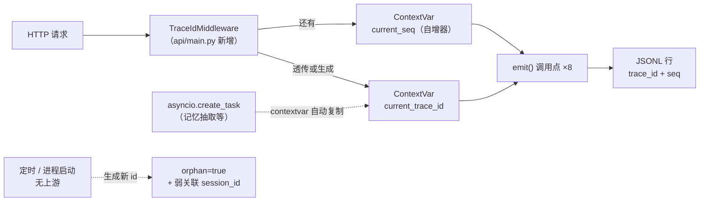

# 设计 — 审计与可观测 v1

> 📋 **规范**：遵循 `docs/规则/文档规范.md`
> 📌 **更新时间**：2026-10-16
> 📝 **版本变更记录**（永久保存，只追加不删除）：
> | 版本 | 日期 | 具体改动 |
> |------|------|---------|
> | v1 | 2026-10-16 | 初版：落实方向决策记录的 D1–D4（双写 / 事前事后 / 全量 PG / 审计≠trace），并对 B1–B6 给出**带推荐值的定案**（不是选项清单）。含统一事件模型 / trace_id 贯穿 / 双写落地 / PG 表结构 / 重放工具 / 保留与脱敏 / 5 批次实施 |

> 🔗 **上游（决策依据，本文只做落地设计，不改结论）**：
> `docs/决策/2026-10-15-决策-审计与可观测-方向-v1.md` v1.3 —— D1–D4 已拍板、B1–B6 待定、§3.5 覆盖边界、§4.1 成本与风险、§4.3 三方选型
> 📌 **实测基线**：本文所有 file:line 实测自 `develop` HEAD `4194d17`

> **目录**：
> - §1 范围
> - §2 现状核实（8 个写入点 / 5 类方言）
> - §3 统一事件模型
> - §4 trace_id 贯穿
> - §5 双写落地（含 PG 表结构）
> - §6 重放工具
> - §7 保留 / 结果 / 脱敏（B4.1–B4.3）
> - §8 覆盖范围
> - §9 实施批次
> - §10 不做清单与风险
> - §11 待确认（**只需确认，不需要选**）

---

## 1. 范围 🔴 v1

| 做 | 不做 |
|---|---|
| 统一事件模型（消 5 类方言） | ❌ 不引入新的外部可观测组件（三方选型见决策记录 §4.3，结论"已用满"） |
| `trace_id` 贯穿（生成 / 继承 / 孤儿） | ❌ 不改业务语义（审计是**旁路**，不参与决策） |
| 双写落地（JSONL 权威 + Redis Stream → PG） | ❌ 不接 Langfuse（co-creator 2026-10-16 已排除） |
| 重放工具 + 保留策略 + 脱敏接入 | ❌ 不做审计查询 UI（Grafana/Metabase 另议） |

**一句话**：把现有"能记但记散、记了查不着"的审计，变成**可关联、可查、可重建**的一条链。

---

## 2. 现状核实（实测） 🔴 v1

### 2.1 八个写入点（决策记录写的是 6 个——少算了一处）

| # | 位置 | layer | 标识字段 | 事件字段 | 其他 |
|---|------|-------|---------|---------|------|
| 1 | `tools/guardrails/audit.py:63` 安全拦截 | `security` | **无** | `event="blocked"` | tool、reason |
| 2 | `tools/guardrails/audit.py:175` 事前行 | `tool_call` | `thread_id` | `phase="start"` | tool、args（敏感脱敏） |
| 3 | `tools/guardrails/audit.py:210` 事后行 | `tool_call` | `thread_id` | `phase="end"` | status、error_code、duration_ms |
| 4 | `core/backend.py:260` 文件访问 | `policy_backend` | `thread_id` | `decision`（allow/deny） | op、path、policy |
| 5 | `sandbox/pool.py:160` 沙箱池 | `sandbox` | `thread_id` | `event` | sandbox_id |
| 6 | `agent/memory/queue.py:114` 记忆队列 | `memory_agent` | `session_id` | `event` | fingerprint、detail |
| 7 | **`agent/memory/agent.py:129` 低质记忆** ⚠️ | **无** | **无** | **无（纯文本行！）** | 只记 `type/quality/fact[:80]` |
| 8 | `agent/middlewares/trace.py:124` 推理 trace | **无** | `session_id`（可空） | `event` | run_id、parent_ids、summary |

> ⚠️ **第 7 点是本次新发现**：它连 JSON 都不是——直接 `audit_logger.info("memory_agent 低质记忆审计 type=…")` 一句话文本。
> **它混在审计流里但格式不同**，任何按 JSON 解析消费审计的下游都会在它这里炸。这正是"没有统一模型"的直接代价。

### 2.2 五类方言（不统一就别谈"关联"）

| 维度 | 现状取值 | 问题 |
|---|---|---|
| **标识字段** | `thread_id`（4 处）/ `session_id`（2 处）/ **无**（2 处） | 同一个东西三个叫法，还有两处没有 |
| **事件字段** | `decision`（1 处）/ `event`（4 处）/ `phase`（2 处）/ **无**（1 处） | 四种语义混在一个概念上 |
| **时间精度** | `timespec="seconds"`（全部审计）| 同秒内多事件**无法排序**（trace 需要顺序） |
| **关联 ID** | 无 | 六条流互不相识（缺口 1） |
| **格式** | JSON（7 处）+ **纯文本**（1 处） | 下游解析必须写特例 |

---

## 3. 统一事件模型 🔴 v1

### 3.1 核心字段（每行必有，7 个）

| 字段 | 类型 | 说明 | 相对现状 |
|---|---|---|---|
| `ts` | ISO 字符串，**毫秒** | 时间戳 | 🟡 精度 seconds → **milliseconds**（同秒可排序） |
| `trace_id` | str | 贯穿 ID（§4） | 🆕 |
| `seq` | int | 同一 trace 内单调递增（幂等键） | 🆕 |
| `layer` | str | 事件来源层（**必填**） | 🟡 两处无 layer → 补齐 |
| `event` | str | **点分命名**：`<layer>.<动作>` | 🟡 合并 `decision`/`event`/`phase` 三种方言 |
| `status` | str \| null | 结果（`ok` / `degraded` / `error` / `denied`） | 🟡 复用 `ToolResult` 口径 |
| `session_id` | str \| null | 会话（**弱关联**，可空） | 🟡 `thread_id` 统一改名 |

> **`thread_id` → `session_id` 的依据**：项目里二者本就是同一个值
> （`ChatContext.session_id` 即 `thread_id`，见 `api/chat.py` 与 `main_agent._build_stream_config`）。
> 统一为 `session_id` 后，**"标识字段"从三套方言收敛为一**。

### 3.2 层自有字段（平铺其后）

**不做统一**——它们本就该各层自定。例如 `tool` / `path` / `sandbox_id` / `fingerprint` / `run_id`。

**规则**：核心字段名**保留字**，层自有字段**不得重名**（如不得再出现 `status`）——由 `emit()` 校验。

### 3.3 事件命名表（点分）

```
api.request.start / api.request.end          ← 新增（请求级）
tool_call.start   / tool_call.end            ← 原 phase
file_access                                  ← 原 decision=allow/deny（决定内容进 policy_decision）
security.blocked                             ← 原 event=blocked
sandbox.acquire / sandbox.release / sandbox.gc
memory.enqueue    / memory.done / memory.low_quality
hitl.request      / hitl.decision            ← 新增（审批，含"谁批的"）
session.create / session.delete / session.compress   ← 新增
```

### 3.4 行样例（改造后）

```json
{"ts":"2026-10-16T09:31:02.481+08:00","trace_id":"3f9c…","seq":7,"layer":"tool_call",
 "event":"tool_call.end","status":"degraded","session_id":"s-42",
 "tool":"fetch_url","error_code":"","retryable":false,"duration_ms":812}
```

### 3.5 唯一写入入口 `emit()`

**新增 `core/audit.py`**：

```python
def emit(layer: str, event: str, *, status: str | None = None, **fields) -> None
```

- 自动补 `ts / trace_id / seq / session_id`（后三者从 ContextVar 取，见 §4）
- **唯一写 JSONL 的地方**（7 处 `audit_logger.info(...)` 全部改为调它）
- 校验：`fields` 不含核心字段保留名（防重名覆盖）
- **失败绝不抛**（审计是旁路，见决策记录 §4.1；写失败只告警）

> **为什么这是本设计的地基**：消方言不是"改字段名"，而是**让所有写入必经同一个门口**——
> 只要还有一处绕过 `emit()`，方言就会重新长出来（第 7 点那种纯文本行就是绕过品）。

---

## 4. trace_id 贯穿 🔴 v1



### 4.1 生成点

**`api/main.py` 新增 `TraceIdMiddleware`**（与既有 CORS / McpMount 中间件同处注册）：

| 输入 | 行为 |
|---|---|
| 请求头带 `X-Trace-Id` | **复用**（支持跨系统串联：前端/网关/其他服务传下来） |
| 未带 | 生成 UUID4 |

### 4.2 继承（**这是最省力的一环**）

Python 的 `asyncio.create_task` **会自动复制当前 context**——所以后台任务（记忆抽取队列）**零改动**即继承发起者的 `trace_id`。

- 现状 `memory/queue.py` 已是 `create_task` 模式 ✅ → **自动继承，不需传参**
- 显式传参作为兜底（跨线程/跨进程场景）

### 4.3 孤儿规则（B6 定案）

| 场景 | 规则 |
|---|---|
| 定时任务 / 进程启动 / 无 context | 生成新 `trace_id` + 标 `orphan: true` |
| **禁止留空** | 留空＝回到"无法关联"（正是缺口 1） |
| 有 `session_id` 时 | 一并写入 → **弱关联**（能回溯到会话，只是不知哪次请求触发） |
| 孤儿率 | 纳入审查（过高说明某条链路没接上） |

---

## 5. 双写落地 🔴 v1

> 架构与风险处置见决策记录 §4.1 / §4.2（**不重复**）。本节只定**实现细节**。

### 5.1 B1 定案：队列与消费者

| 项 | 定案 | 理由 |
|---|---|---|
| 队列 | **Redis Stream**，key `audit:stream` | 有 consumer group + ack + 可回放（决策记录 §4.1.2） |
| 消费组 | `audit-writers` | 支持多消费者水平扩展 |
| 消费者 | **首版：FastAPI 内后台任务**；开关 `AUDIT_WORKER_MODE=embedded\|standalone` | 首版少一个部署单元；上云切 standalone **不改代码** |
| 死信 | **PG 表 `audit_dead_letter`**（不用 Redis） | Redis 也可能挂；死信放 PG 更稳，且可 SQL 查 |

### 5.2 写入顺序（关键，不可颠倒）

```
① emit() → 写 JSONL（权威底账，必成功）
② 投 Redis Stream（XADD）
```

业务线程**只等 ①**。②失败 → 记告警（底账已有，PG 可事后重放补齐）。

### 5.3 PG 表结构

```sql
-- 审计事件（派生索引，可从 JSONL 重建）
CREATE TABLE IF NOT EXISTS audit_events (
    id         BIGINT GENERATED BY DEFAULT AS IDENTITY PRIMARY KEY,
    trace_id   TEXT        NOT NULL,
    seq        INTEGER     NOT NULL,
    ts         TIMESTAMPTZ NOT NULL,
    layer      TEXT        NOT NULL,
    event      TEXT        NOT NULL,
    status     TEXT,
    session_id TEXT,
    payload    JSONB       NOT NULL DEFAULT '{}',   -- 层自有字段
    UNIQUE (trace_id, seq)                          -- ← 重放幂等的依据
);
CREATE INDEX IF NOT EXISTS idx_audit_session ON audit_events (session_id, ts DESC);
CREATE INDEX IF NOT EXISTS idx_audit_layer   ON audit_events (layer, ts DESC);
CREATE INDEX IF NOT EXISTS idx_audit_trace   ON audit_events (trace_id);

-- 死信（超重试上限的坏事件，不静默丢）
CREATE TABLE IF NOT EXISTS audit_dead_letter (
    id         BIGINT GENERATED BY DEFAULT AS IDENTITY PRIMARY KEY,
    raw_line   JSONB  NOT NULL,
    error      TEXT   NOT NULL,
    attempts   INTEGER NOT NULL,
    created_at TIMESTAMPTZ NOT NULL
);
```

**为什么"核心字段建列 + 其余进 `payload` JSONB"**：
- 核心字段是**要按它查/排序/去重**的（`session_id` / `layer` / `ts` / `trace_id+seq`）→ 必须是列
- 层自有字段各层不同（`path`/`tool`/`sandbox_id`/`fingerprint`…），全展开会变成一张**每加一层就要改表的宽表** → 进 JSONB
- 仍可对 JSONB 建 GIN 索引（将来需要时，不改表结构）

### 5.4 幂等与背压

| 机制 | 做法 |
|---|---|
| **幂等** | `UNIQUE (trace_id, seq)` + `INSERT ... ON CONFLICT DO NOTHING`（重放可安全重复执行） |
| 重试 | 不 ack → 留 PEL → 重启后 `XCLAIM` 重投；**每消息上限 3 次** |
| 超限 | 写 `audit_dead_letter` + 告警（**不静默丢**） |
| 背压 | `XADD MAXLEN ~ 10万`；逼近上限 → **降级只保 JSONL**（`AUDIT_DEGRADED` 标记 + 告警） |

---

## 6. 重放工具 🔴 v1（**必做项**，非可选）

```python
async def rebuild_from_jsonl(start: datetime, end: datetime) -> dict
```

- 读 JSONL（可指定时间范围 / 文件）→ 逐行解析 → `INSERT ... ON CONFLICT DO NOTHING`
- 返回 `{"scanned": n, "inserted": m, "skipped": k, "failed": [行号]}`
- **用途**：① PG 丢消息 ② 降级期补录 ③ 迁移重建 ④ **一致性校验**（扫 JSONL 与 PG 条数差）

> **没有它，"PG 可重建"就只是口号**（决策记录 §4.1.5 已定为必做）。

---

## 7. 保留 / 结果 / 脱敏 🔴 v1（B4.1–B4.3 定案）

| 项 | 定案 | 依据 |
|---|---|---|
| **B4.1 保留期** | **按 layer 分档**：`security`/`hitl` **3 年**；`tool_call`/`file_access`/`api` **1 年**；`sandbox`/`memory_agent` **90 天**。JSONL 同期**压缩归档**（`.gz`）而非删除 | 读类噪音占绝大多数；安全事件须长期（决策记录 §5.1） |
| **B4.2 结果入库** | **不入正文**，只入 **`result_sha256` + `result_len`**（定长指纹） | 可校验不可读；避免第二处敏感数据面（§5.1） |
| **B4.3 脱敏** | **复用 `llm/redact.py` 的同一张规则表**，并把 `redacted_counts`（脱了几处/哪类）写进行 | 规则一处（本项目反复踩"两处漂移"）；脱敏后保留元信息，否则审计失真 |

> ⚠️ **不复用日志的"保留 14 个"**——那是排障日志参数，审计必须更长（决策记录 §4.1.4）。

---

## 8. 覆盖范围 🔴 v1

**完全沿用决策记录 §3.5**（不在范围的 9 类 + 总原则「记谁对这个系统做了什么动作，不记系统处理的内容」）。

本文新增的三层（`api` / `hitl` / `session`）即 §3.5 表末已列出的"**新增**"项，本设计负责落地。

---

## 9. 实施批次 🔴 v1

```
批次 1｜事件模型 + emit 收口        ← 本设计的地基，**零行为变更**
        core/audit.py（emit + 校验 + ContextVar 占位）
        7 处 audit_logger.info → emit()；第 7 点纯文本行**改为 JSON**
        字段改造：ts 毫秒 / thread_id→session_id / decision·event·phase→event 点分
        统一测试（断言"不再有绕过 emit 的写入"）
        ← 仍只写 JSONL，不接 Redis/PG，可独立回滚

批次 2｜trace_id 贯穿
        TraceIdMiddleware（含 X-Trace-Id 透传）+ seq 自增 + 孤儿规则
        ← 此时 JSONL 行已有完整 trace_id，具备"能关联"的最小价值

批次 3｜双写落地
        Redis Stream + 消费 worker（embedded，带 standalone 开关）
        + PG 表 + 死信 + 背压降级

批次 4｜重放工具 + 保留策略 + 脱敏接入
        rebuild_from_jsonl + 归档任务 + redact 接入 + redacted_counts

批次 5｜收口：文案 diff 表 / 架构文档同步 / 全量回归
```

**批次 1 可以先做**——它**零外部依赖**（不需要 Redis/PG）、零行为变更，且立刻解决两个真问题（同秒无法排序、第 7 点纯文本行）。

---

## 10. 不做清单与风险 🔴 v1

| 不做 | 原因 |
|---|---|
| 审计参与决策（拦截/放行） | 审计是**旁路**；参与决策会让"账本"变成"开关"，故障面翻倍 |
| 引入 Langfuse / 新可观测组件 | 三方选型已用满（决策记录 §4.3） |
| 审计查询 UI | 另议（Grafana / Metabase） |
| 记录 LLM 正文 / 文件内容 | §3.5 边界第 1、2 条 |

| 风险 | 处置 |
|---|---|
| 批次 1 改 8 个写入点 → 回归面广 | 批次 1 只改"怎么落行"，不改"记什么"；逐点补测试 + 全量回归 |
| `emit()` 被绕过（又长新方言） | 立测试：AST 扫描全仓 `audit_logger.info` 直调 → 出现即红（**同 `test_layering.py` 的手法**）|
| Redis/PG 不可达阻塞业务 | 顺序保证：业务只等 ①；②③ 失败均降级 + 告警（§5.2） |

---

## 11. 待确认（**只需确认，不需要选**） 🔴 v1

> 上一轮 co-creator 反馈"列 6 点让我决策太多了"。本节把 B1–B6 与设计选择**全部写成推荐值**——
> 你只需"确认"或指出"哪条要改"，不需要在选项间做选择。

| # | 我的定案 | 一句话理由 | 你只需 |
|---|---|---|---|
| B1 | Redis Stream + `audit-writers` 组；首版 embedded worker（开关可切） | 崩溃不丢 + 首版少一个部署单元 | 确认 |
| B2 | trace 留 JSONL，不进 PG | 采样/短期，与审计保留策略不同 | 确认 |
| B3 | 后台任务继承 `trace_id`（contextvar 自动） | `create_task` 自动复制 context，**零改动** | 确认 |
| B4.1 | 保留按 layer 分档（3 年 / 1 年 / 90 天） | 钱花在刀刃上（安全长期、读类短） | 确认 |
| B4.2 | 结果不入库，只存 `sha256 + len` | 可校验不可读，免第二处泄漏面 | 确认 |
| B4.3 | 复用 `llm/redact.py` 同一规则表 + 记计数 | 规则一处，避免两处漂移 | 确认 |
| B5 | 首版全采；`error` 必采；决策在入口做一次 | 省成本但**绝不断链** | 确认 |
| B6 | 孤儿：新 id + `orphan=true` + 弱关联 session | 禁止留空（留空＝回到无法关联） | 确认 |
| B7 | **先做批次 1**（零依赖、零行为变更） | 立刻解决"同秒无法排序"+ 纯文本行 | 确认 |

---

> 🔗 **关联**：`docs/索引.md`（唯一入口）｜`docs/决策/2026-10-15-决策-审计与可观测-方向-v1.md`（上游决策）｜
> `docs/决策/2026-10-14-设计-工具中心阶段2输出侧-v1.md`（`ToolResult` 三态口径来源）｜
> `docs/决策/2026-10-15-计划-PG迁移-v1.md`（PG 连接层）
