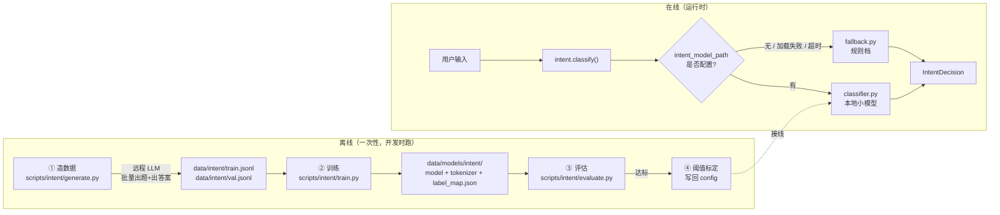

# 设计 — 意图识别蒸馏方案 v1

> 📋 **规范**：遵循 `docs/规则/文档规范.md`
> 📌 **更新时间**：2026-10-16
> 📝 **版本变更记录**（永久保存，只追加不删除）：
> | 版本 | 日期 | 具体改动 |
> |------|------|---------|
> | v1 | 2026-10-16 | 初版：零样本 NLI 三组实测判负 → 选定蒸馏（A）→ 总体链路 + **落点（脚本/接口/产物位置）** + 数据生成 + 训练 + 推理接线 + 评估验收 + 成本回本 + 待拍板 Q1–Q5 + 实施批次 + 核心代码 |

> 🔗 **上游**：`docs/决策/2026-10-15-设计-意图识别-v2.md`（本方案是它 §5.1「演进路径」的具体化）
> ｜`docs/临时/2026-10-14-汇总-工具中心分支开发笔记-v1.md` P19（本地先装、服务器暂不装）
> ｜`.claude/rules/08-dependency-policy.md`（能用第三方就用第三方）
> 📌 **实测基线**：`develop` HEAD `3d76646`；实验环境 Windows / Python 3.14 / torch 2.14.1+cpu

> **目录**：
> - §1 背景与结论（为什么放弃零样本 NLI）
> - §2 总体链路（Mermaid）
> - §3 **落点：脚本 vs 接口**（直接回答"写什么、放哪里"）
> - §4 数据生成
> - §5 训练
> - §6 推理接线
> - §7 评估与验收门槛
> - §8 成本与回本
> - §9 目录与依赖影响
> - §10 不做清单
> - §11 风险
> - §12 待拍板决策点 🔴
> - §13 实施批次
> - §14 面试要点
> - §15 完整核心代码
> - §16 关联

---

## 1. 背景与结论 🔴 v1

### 1.1 实测证据：零样本 NLI 判负

| # | 模型 | 判定方式 | 结果 |
|---|---|---|---|
| 1 | `IDEA-CCNL/Erlangshen-Roberta-110M-NLI` | 意图**长描述**当假设 | **2/19 = 10.5%** |
| 2 | 同上 | 短标签 + 「这段话属于{}。」模板 | 1/6 |
| 3 | `MoritzLaurer/mDeBERTa-v3-base-mnli-xnli`（278M） | 短标签 + 中文模板 | 2/6 |

延迟是够的（Erlangshen 7 假设全跑：**p50 132ms / p95 193ms**），**问题只在准确率**。

典型失败（mDeBERTa）：

```
你好呀，最近怎么样   → 文本摘要 0.530   ✗
帮我查今天的气温     → 文本摘要 0.307   ✗
帮我调试这段 Python  → 代码执行 0.954   ✓
帮我总结这篇文档要点 → 文本摘要 0.997   ✓
写一首关于秋天的诗   → 文本摘要 0.552   ✗
什么是 ReAct 循环    → 代码执行 0.651   ✗
```

### 1.2 为什么 NLI 不行（根因，不是调参问题）

```
NLI 判的是：前提是否【蕴含】假设   —— 一个事实推理关系
意图分类判的是：用户想【干什么】     —— 一个语用问题
```

"你好呀" 与 "闲聊" 之间**不存在 entailment 关系**，模型只能靠边际分布瞎猜。
两个模型都表现出同一退化模式：**整批样本往某一个标签上堆**。

> 📌 结论：**零样本 NLI 在本任务上不成立**，与阈值、模板、标签长短都无关。

### 1.3 选定方向：A — 蒸馏

**做法**：远程 LLM 批量生成「用户输入 → 意图标签」样本 → 本地训练一个小分类模型 → 上线后**零大模型调用**。

**为什么选它**（对照备选 B「向量 + 最近邻」）：

| | A 蒸馏 | B 向量+最近邻 |
|---|---|---|
| 加新意图 | 要重训 | 加样品即可 |
| 准确率上限 | 高 | 中上 |
| 判定开销 | 最低（一次前向） | 多一次比对 |
| 面试故事 | **最硬**（大模型蒸馏小模型） | 一般 |

> 选 A 的决定性理由：这正是 `2026-10-15-设计-意图识别-v2.md` §5.1 写定的**目标形态**，
> 且「用大模型蒸馏小模型替代它做简单判断」是完整可讲的成本优化故事。

---

## 2. 总体链路 🔴 v1



**关键点**：离线与在线是**两个世界**。训练脚本只在开发时跑；线上只加载一个权重文件。

---

## 3. 落点：脚本 vs 接口 🔴 v1

> 直接回答："是不是要专门写个接口或者写个脚本？这些东西放哪里？"

### 3.1 不需要新接口 ✅

| 疑问 | 结论 |
|---|---|
| 要不要开 HTTP API 给意图识别？ | **不要**。意图识别是 `chat.py` 内部的**前置步骤**，没有外部消费者 |
| 要不要做成 MCP / A2A 服务？ | **不要**。本轮早前已拍板：本服务仅供内部使用（A2A 方案整体移除） |
| 前端要不要直接调？ | 不要。判定结果不进 SSE 协议（`schemas/events.py` 固定 8 类事件） |

**运行时的"接口"就是现有的 `src/intent/__init__.py::classify()`**——签名不变，内部多一档。

### 3.2 需要 3 个离线脚本

放 **`backend/scripts/intent/`**（新建子目录；与 `scripts/` 下既有的 `audit_tool_descriptions.py`、`lint_tools.py` 同级归置）。

| 脚本 | 职责 | 何时跑 |
|---|---|---|
| `generate.py` | 调远程 LLM 造标注数据 | 首次 + 加意图时 |
| `train.py` | 用数据集微调小模型 → 导出产物 | 数据更新后 |
| `evaluate.py` | 混淆矩阵 / P·R·F1 / 延迟 / 阈值标定 | 训练后 + 每次改模型 |

> 📌 已存在的 `backend/scripts/intent_model_eval.py`（本轮实测 NLI 用的）**并入 `evaluate.py` 或保留为对照组**——
> 它测的是"零样本基线"，作为蒸馏效果的**对照数字**仍有价值。

### 3.3 运行时只新增 1 个文件

| 动作 | 路径 |
|---|---|
| 新增 | `backend/src/intent/classifier.py` —— 本地模型加载 + 推断（**唯一**运行时新增代码） |
| 新增 | `backend/src/intent/prompts.py` —— 造数据用的 prompt 模板（离线用，但归在能力域内便于同步） |

### 3.4 产物位置（**不进库**）

| 产物 | 路径 | 入库? |
|---|---|---|
| 数据集 | `data/intent/train.jsonl` / `val.jsonl` | ❌ `data/` 已 gitignore |
| 模型权重 | `data/models/intent/model.safetensors` | ❌ 二进制，且可由脚本重建 |
| 分词器 | `data/models/intent/tokenizer.json` 等 | ❌ 同上 |
| **标签映射** | `data/models/intent/label_map.json` | ❌ 可从 `INTENT_REGISTRY` 重新生成 |

> **为什么都不入库**：模型 60–100MB，不适合 git；且**生成配置与 prompt 在代码里（已入库）**，任何人都能一键重建。
> 这比"往仓库塞模型"更干净——仓库只留**能重建产物的方法**。

⚠️ `core/paths.py` 需**登记**新增的两个数据目录（规则 06 §3：新增数据目录必须登记）。

---

## 4. 数据生成 🔴 v1

### 4.1 规模与切分

| 项 | 值 | 说明 |
|---|---|---|
| 每意图样本数 | **200**（起步） | 7 类共 1400 |
| 切分 | **8:2 分层** | 1120 训练 / 280 验证 |
| 最大长度 | 64 token | 意图判定输入都很短 |

> **"够不够"由 §7 的混淆矩阵回答**，不靠拍脑袋。不够的信号见 §7.3。

### 4.2 生成策略（决定成败的一步）

1. **多样性 > 数量**：每个意图覆盖不同句式、长度（5–60 字）、语域（口语/书面/夹英文）
2. **真实感**：prompt 明确要求"模仿真实用户口吻，允许口语与轻度错别字"
3. **边界样本**：每类额外造 **10–20 条易混句**（如 `summarize` vs `query_knowledge` 的对偶说法）
4. **难度分层**：显式/隐式/带干扰信息三类各占一定比例
5. **去重**：文本归一化后精确去重 + 近似去重（避免"换个词"当新样本）

### 4.3 存储格式

```jsonl
{"text": "帮我总结这篇文档要点", "label": "summarize", "src": "llm", "model": "deepseek-v4-flash", "round": 1}
{"text": "今天心情不错", "label": "chat", "src": "manual", "round": 1}
```

`src` 区分来源（`llm` / `manual` / `badcase`）——**上线后回流的真实 bad case 标 `badcase`**，
这是"数据飞轮"的落点，也是面试可讲的量化素材。

### 4.4 质量闸门（自动 + 人工）

| 闸门 | 规则 |
|---|---|
| 自动 | 长度 3–200 字；纯中文/中英混排；标签必须在 `INTENT_REGISTRY` 里 |
| 自动 | 各类必须 exact 200 条（不足则补生成，多则随机裁剪） |
| **人工** | 每类随机抽 **10 条**过目（70 条，约 10 分钟），确认不是"教科书废话" |

---

## 5. 训练 🔴 v1

### 5.1 基座模型候选（⚠️ 待实测选型）

| 候选 | 参数量 | 说明 |
|---|---|---|
| `hfl/chinese-roberta-wwm-ext-small` | ~40M | 小、中文原生，**首选** |
| `uer/chinese_roberta_L-4_H-256` | ~16M | 极小，若准确率够用则更省内存 |
| `BAAI/bge-small-zh-v1.5` + 分类头 | ~24M | 若直接用 embedding 效果更好则切换 |

> 选型方式与零样本那轮一致：**跑 `evaluate.py` 比准确率/内存/延迟，数据说话**。

### 5.2 训练配置

| 项 | 值 | 理由 |
|---|---|---|
| 框架 | `transformers.Trainer`（**不手写训练循环** —— 规则 08 第三方优先） | 已装依赖 |
| 优化器 | AdamW，lr=2e-5 | 小模型微调常规值 |
| epochs | 3–5 + **early stopping（按 val macro-F1）** | 防过拟合 |
| batch | 16 / 32 | CPU 可跑 |
| 随机种子 | 固定 42 | **可复现**（否则调不动） |

### 5.3 产物格式

```
data/models/intent/
├── model.safetensors      # 权重（int8 量化可选）
├── config.json
├── tokenizer.json / vocab.txt
└── label_map.json         # {"0":"chat","1":"tool_call",...} ← 与 INTENT_REGISTRY 对齐
```

⚠️ **`label_map.json` 是模型与业务之间的契约**，见 §6.2 的一致性锁。

---

## 6. 推理接线 🔴 v1

### 6.1 `classifier.py` 的职责

```
classify_with_model(text, settings) -> IntentDecision
   ├─ 懒加载（首次调用才 load，失败 → 抛 ModelUnavailableError）
   ├─ 分词 + 一次前向 → softmax → 每个意图一个分数
   ├─ 按 settings.intent_threshold 取多标签，降序
   └─ 返回 source="model", degraded=False
```

**懒加载是 P19 的硬要求**：加载失败不得阻塞应用启动，降级到规则档即可。

### 6.2 🔴 一致性锁（新增，防"模型与登记表脱节"）

```python
# 启动/首次加载时校验
model_labels = set(json.loads(label_map_path.read_text()))     # 模型认识的标签
registry_labels = set(INTENT_REGISTRY)                          # 业务要的标签
if model_labels != registry_labels:
    raise ModelUnavailableError("模型标签与意图登记表不一致，降级到规则档")
```

**为什么必须**：加了新意图但忘了重训 → 模型永远判不出新意图，且**不会报错**，
表现为"新意图形同虚设"。这正是工具中心反复清算的"两处清单打架"。

### 6.3 超时与降级

```
asyncio.wait_for(to_thread(推断), timeout=intent_timeout_ms/1000)
   ├─ 超时 → IntentTimeoutError → 规则档
   └─ 其他异常 → ModelUnavailableError → 规则档
```

CPU 单次推断预期 **10–50ms**（110M 量级实测 p50 132ms 是 7 次前向；蒸馏分类器只要 1 次）。

---

## 7. 评估与验收门槛 🔴 v1

### 7.1 指标

| 指标 | 说明 |
|---|---|
| 整体准确率 | 验证集 280 条上的 top-1 |
| 每类 P / R / F1 | 找出弱类 |
| **混淆矩阵** | 找出"谁被误判成谁" |
| 延迟 p50 / p95 | 判定开销 |
| 峰值内存 | 决定服务器是否背得起 |

### 7.2 验收门槛（**不达标不接线**）

| 门 | 阈值 |
|---|---|
| 整体准确率 | **≥ 90%** |
| 每类召回 | **≥ 80%** |
| 延迟 p95 | **≤ 300ms**（与 `intent_timeout_ms` 预算一致） |
| 峰值内存 | ≤ 800MB（含 torch 运行时） |
| 对照基线 | 必须**明显优于**规则档，否则不值得引入模型 |

### 7.3 "数据不够"的信号

| 现象 | 处置 |
|---|---|
| 某类召回 < 80% | 该类样本不够或太单一 → 补多样性 |
| 两类互相串（如 summarize ↔ query_knowledge） | 边界本身模糊 → 造**对比样本**（只差一个词的对偶句） |
| 训练集 99% / 验证集 75% | 过拟合 → 加数据或减 epoch |

---

## 8. 成本与回本 🔴 v1

| 项 | 量 |
|---|---|
| 造 1400 条数据（一次性） | ≈ 8–10 万 token（几毛钱量级） |
| 训练（本地 CPU） | 0 元 |
| **蒸馏前**：每条消息判定 | ≈ 200 token |
| **蒸馏后**：每条消息判定 | **0 token**（本地推断） |
| **回本点** | 约 **400–500 次请求** |

⚠️ 省的是 **token 钱**，换来的是 **CPU/内存**——这正是 P19 要账的地方。

---

## 9. 目录与依赖影响 🔴 v1

| 动作 | 路径 | 说明 |
|---|---|---|
| 新增 | `backend/scripts/intent/generate.py` | 造数据（离线） |
| 新增 | `backend/scripts/intent/train.py` | 训练（离线） |
| 新增 | `backend/scripts/intent/evaluate.py` | 评估（离线；吸收现有 `intent_model_eval.py`） |
| 保留 | `backend/scripts/intent_model_eval.py` | 零样本基线对照 |
| 新增 | `backend/src/intent/classifier.py` | **唯一运行时新增代码** |
| 新增 | `backend/src/intent/prompts.py` | 造数据 prompt 模板 |
| 改 | `backend/src/intent/__init__.py` | `classify()` 插入模型档（`intent_model_path` 非空时） |
| 改 | `backend/src/core/paths.py` | 登记 `data/intent/` 与 `data/models/intent/` |
| 改 | `pyproject.toml` | 可选依赖组 `intent`（`torch` + `transformers`），沿用 RAG 设计的可选组范式 |
| 数据/模型 | `data/intent/`、`data/models/intent/` | **不入库**，可由脚本重建 |

---

## 10. 不做清单 🔴 v1

| 不做 | 原因 |
|---|---|
| 新增 HTTP / MCP / A2A 接口 | 内部前置步骤，无外部消费者（A2A 已整体移除） |
| 把模型或数据集提交进 git | 60–100MB 二进制；生成方法与 prompt 已入库，可重建 |
| 手写训练循环 | 规则 08：用 `transformers.Trainer` |
| 继续在 NLI 上调参 | §1 已实测判负，属沉没成本 |
| 首版做在线学习 / 增量训练 | 无数据管线，且会引入一致性风险 |
| GPU 训练/推理 | 40M 量级模型 CPU 足够 |

---

## 11. 风险 🔴 v1

| # | 风险 | 处置 |
|---|---|---|
| R1 | **LLM 造的数据太"教科书"**，与真实输入分布不符 | prompt 要求真实口吻 + 人工抽检 70 条 + 上线后 bad case 回流 |
| R2 | **模型标签与登记表脱节**（加意图忘重训） | §6.2 一致性锁：不一致即降级，且**日志告警** |
| R3 | **过拟合**（1400 条对 40M 模型偏少） | early stopping + 8:2 验证 + 交叉验证兜底 |
| R4 | **内存超限** | int8 量化 + 懒加载 + `intent_model_path` 留空即不加载 |
| R5 | 训练不可复现 | 固定 seed + 数据集版本号写进模型目录 |
| R6 | 类别不平衡（LLM 生成偏多/偏少） | 生成阶段强制每类 200，训练前校验 |

---

## 12. 待拍板决策点 🔴 v1

| # | 决策 | 选项 | 建议 |
|---|---|---|---|
| **Q1** | 基座模型 | (a) chinese-roberta-small（40M）｜(b) uer L-4_H-256（16M）｜(c) bge-small-zh + 分类头 | 三个都跑 `evaluate.py` 比数据后再定（**不预选**） |
| **Q2** | 每类样本数 | (a) 200（共 1400）｜(b) 500（共 3500） | (a) 起步，按 §7.3 的信号再加 |
| **Q3** | 模型产物是否入库 | (a) 不入库，脚本重建｜(b) 入 git（LFS） | (a) —— 仓库只留可重建的方法 |
| **Q4** | 是否引入 `SetFit` 等专用少样本分类库 | (a) 不引入，用 `transformers.Trainer`｜(b) 引入 | (a) 先用已装依赖；不达标再评估 |
| **Q5** | 加新意图时的流程 | (a) 补数据 + 全量重训｜(b) 只训新增类的分类头 | (a) 简单可靠（数据量小，重训成本低） |

---

## 13. 实施批次 🔴 v1

```
批次 1｜造数据：scripts/intent/generate.py + prompts.py + 数据集落 data/intent/
        ← 人工抽检 70 条后才算完成
批次 2｜训练：scripts/intent/train.py + 基座选型对比（Q1）→ 产出 data/models/intent/
批次 3｜评估：scripts/intent/evaluate.py + 混淆矩阵 + 阈值标定
        ← 未过 §7.2 门槛则回批次 1 补数据，**不得硬接**
批次 4｜接线：src/intent/classifier.py + 一致性锁 + 降级 + config 接线
批次 5｜回填：设计文档实测数据 + P19 触发条件 + 功能更新日志
```

每批次可独立回滚（批次 4 之前线上行为完全不变）。

---

## 14. 面试要点（对照备战指南 §3.2 / §3.3） 🔴 v1

| 项 | 内容 |
|---|---|
| **覆盖模块** | **评估体系（P0）**：混淆矩阵 + 验收门槛 + bad case 归因｜**成本控制（P1）**：大模型蒸馏小模型，在线判定 0 token，回本点 400–500 次｜**容错（P1）**：懒加载失败降级规则档 |
| **架构层追问** | "为什么不用 API 做意图判定？"→ 高频、简单、可蒸馏的判断，每次调大模型是浪费；且延迟压在首 token 上。｜"为什么不做成独立服务？"→ 无外部消费者，A2A 方案已整体移除 |
| **实现层追问** | "数据哪来的？"→ 大模型造 1400 条 + 人工抽检 + 上线后 bad case 回流（**数据飞轮**）。｜"怎么防模型和业务脱节？"→ `label_map` 与 `INTENT_REGISTRY` 一致性锁，不一致即降级 |
| **效果层追问** | 准确率 / 每类召回 / 混淆矩阵 / 延迟 p95 / 峰值内存 / 对照规则基线的提升 |
| **优化层追问** | ① bad case 回流再训（飞轮）② 阈值用真实分布标定 ③ 加意图时补数据重训 ④ 量化/更小基座降内存 |
| **可量化指标** | 准确率、每类召回、在线判定 token 节省（100%）、回本点、首 token 延迟变化、峰值内存 |

---

## 15. 完整核心代码 🔴 v1

> 形态演示；参数与选型以批次实测为准。

### 15.1 造数据（`scripts/intent/generate.py` 核心）

```python
GENERATE_PROMPT = """你是数据标注员。请为「{intent_name}」这个意图生成 {count} 条中文用户请求。

意图语义：{description}
正例参考：{examples}

要求：
1. 模仿真实用户口吻，长度 5–60 字随机，允许口语与轻度错别字
2. 句式多样：疑问句 / 祈使句 / 陈述句混合；允许夹英文词
3. **禁止**出现「意图」「分类」「标签」等元词汇
4. 只输出 JSON 数组，元素为字符串，不要解释

输出：["...", "..."]"""


async def generate_for_intent(intent_name: str, count: int, llm: LLMAdapter) -> list[str]:
    """为单个意图生成 count 条候选样本（失败重试交给 LLMAdapter）。"""
    spec = INTENT_REGISTRY[intent_name]
    raw = await llm.chat(GENERATE_PROMPT.format(
        intent_name=intent_name, description=spec.description,
        examples="；".join(spec.examples), count=count,
    ))
    return _parse_and_filter(raw, count)   # JSON 解析 + 长度/去重过滤
```

### 15.2 训练（`scripts/intent/train.py` 核心）

```python
def train(dataset_dir: Path, out_dir: Path, base_model: str) -> dict[str, float]:
    """微调小分类模型并导出（含 label_map 契约）。"""
    train_ds = load_jsonl(dataset_dir / "train.jsonl")
    val_ds = load_jsonl(dataset_dir / "val.jsonl")

    tokenizer = AutoTokenizer.from_pretrained(base_model)
    model = AutoModelForSequenceClassification.from_pretrained(
        base_model, num_labels=len(INTENT_REGISTRY),
    )
    trainer = Trainer(
        model=model,
        args=TrainingArguments(
            output_dir=str(out_dir / "_ckpt"),
            learning_rate=2e-5, num_train_epochs=5, per_device_train_batch_size=16,
            eval_strategy="epoch", save_strategy="no",
            load_best_model_at_end=False, seed=42, report_to=[],
        ),
        train_dataset=to_dataset(train_ds, tokenizer),
        eval_dataset=to_dataset(val_ds, tokenizer),
        compute_metrics=macro_f1,   # early stopping 依据
    )
    trainer.train()
    model.save_pretrained(out_dir)
    tokenizer.save_pretrained(out_dir)
    write_label_map(out_dir / "label_map.json")   # 与 INTENT_REGISTRY 对齐
    return trainer.evaluate()
```

### 15.3 运行时（`src/intent/classifier.py` 核心）

```python
_model: _LoadedModel | None = None


def _load(settings) -> "_LoadedModel":
    """懒加载模型并校验标签契约（失败抛 ModelUnavailableError，由上层降级）。"""
    global _model
    if _model is not None:
        return _model
    path = Path(settings.intent_model_path)
    label_map = json.loads((path / "label_map.json").read_text(encoding="utf-8"))
    if set(label_map.values()) != set(INTENT_REGISTRY):
        raise ModelUnavailableError("模型标签与意图登记表不一致")
    _model = _LoadedModel(
        tokenizer=AutoTokenizer.from_pretrained(path),
        model=AutoModelForSequenceClassification.from_pretrained(path).eval(),
        labels=label_map,
    )
    return _model


def classify_with_model(text: str, settings) -> IntentDecision:
    """本地小模型判定（同步；调用方负责超时包装）。"""
    loaded = _load(settings)
    scores = loaded.infer(text)          # 一次前向 → {intent: prob}
    intents = tuple(k for k, v in sorted(scores.items(), key=lambda kv: -kv[1])
                    if v >= settings.intent_threshold)
    return IntentDecision(intents=intents, scores=scores, source="model", degraded=False)
```

---

## 16. 关联 🔴 v1

> 🔗 `docs/索引.md`（唯一入口）｜
> `docs/决策/2026-10-15-设计-意图识别-v2.md`（本方案的上游总设计，§5.1 演进路径）｜
> `docs/临时/2026-10-14-汇总-工具中心分支开发笔记-v1.md` P19（本地先装 / 服务器暂不装 / 四条硬要求）｜
> `docs/决策/2026-09-14-设计-资料检索与RAG基础系统-v1.md` §2.1（可选依赖组范式）｜
> `.claude/rules/08-dependency-policy.md`（第三方优先）｜
> `docs/学习/面试/2026-08-10-学习-Agent面试备战指南-v1.md`（§3.2 P0–P2 / §3.3 追问链）｜
> 实验脚本：`backend/scripts/intent_model_eval.py`（零样本基线，对照用）
