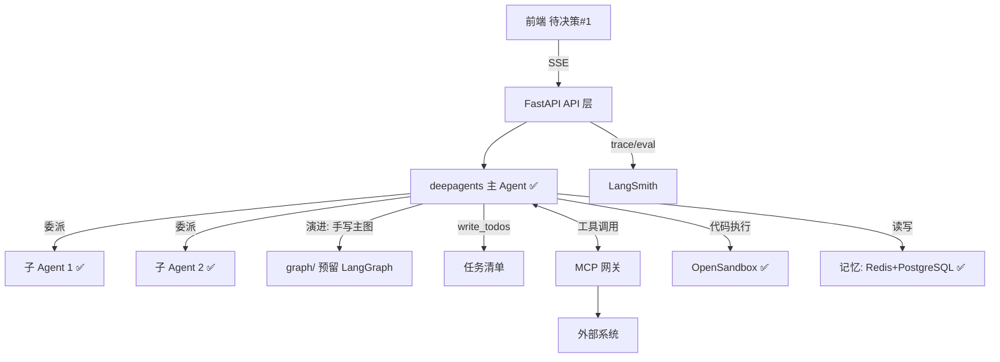

# 多 Agent 项目 — 前后端架构目录 v2（拍板版）

> 📋 **规范**：遵循 `docs/规则/文档规范.md`
> 📌 **更新时间**：2026-10-16
> 📝 **版本变更记录**（永久保存，只追加不删除）：
> 
> | 版本 | 日期 | 具体改动（精确到二级标题） |
> |------|------|------|
> | v2.18 | 2026-10-16 | **§2 目录树 `core/` 补 `json_repair.py`**：LLM 输出 JSON 的**语法**兜底（B15，第三方 `json-repair`，只修语法不改语义；接在 `tools/impl/json_extract.py`）|
> | v2.17 | 2026-10-16 | **§2 目录树按磁盘全面复核重写（修正长期脱节）**：① `tools/guardrails/` → **`tools/runtime/`**（co-creator 拍板：该目录实装 validators（有拦截权）+ audit（只记录）+ gateway（跨切面收口点），"护栏"名不副实；`git mv` 保历史 + 36 处引用同步，**零行为变更**）；② 删去**已不存在**的 `deploy/nginx.conf`·`deploy/.env.prod`·`skill-resources/`·`download/`·`docs/architecture|agent-manual|learnings/`·`backend/{pyproject.toml,docker-compose.yml,langgraph.json}`；③ **改位置**：`pyproject.toml`/`docker-compose.yml`/`.env.example`/`scripts/dev.sh|dev.bat|dev-restart.*` 均在**仓库根**（非 `backend/` 下），原树误挂 backend；④ 补漏 `frontend/scripts`·`frontend/src/lib/api`·`backend/assets`·`backend/examples`·`llm/cache.py`·`scripts/demo_interview.py`·仓库根 `main.py`/`README.md` 等；⑤ 标注 `api/sessions.py` **承担历史**（原树写的 `history.py` 不存在）、`auth/` 为**尚未创建**的蓝图；⑥ 标注 `db/session_repo.py` 仓库**唯一破例命名**；⑦ **清理 `src/mcp/` 空目录残留**（git 未跟踪的陈旧字节码，2026-10-15 已宣布收拢但目录未删）|
> | v2.16 | 2026-10-16 | **§2 审计与可观测落地**：§2 目录树 `core/` 补 `audit.py`（唯一写入入口 `emit()`）与 `audit_stream.py`（双写第二路）；`db/` 仓储清单补 `audit`。**审计流由两条（`file_access_audit.jsonl` / `agent_trace.jsonl`）收敛为**：底账 JSONL 统一事件模型 + 派生索引 PG `audit_events` |
> | v2.15 | 2026-10-15 | **§2 MCP 工具治理落地**：§2 目录树 `db/` 子树补 `mcp_meta_repository`；§2.1 能力落地表「远程 MCP 工具」行更新为**连接表 + 治理表**双表，并写明"未登记不挂载 + 市场安装自动登记"两条路径 |
> | v2.14 | 2026-10-15 | **§2 工具中心一级收拢**：`tools/` 平铺的 6 个文件收进两个二级目录——`contract/`（`result`·`adapter`·`error_map`，工具"长什么样"）+ `guardrails/`（`validators`·`audit`·`gateway`，进/出边界的约束）；`registry.py` 留一级（门面）。纯移动（`git mv` 保历史）+ 40 处 import 路径同步，**零行为变更**（168 用例绿）|
> | v2.13 | 2026-10-15 | **§2 目录树对齐实际（工具中心收拢遗留）**：`backend/src/` 子树重写——删去**已不存在的 `mcp/`**（registry/server/http_base/adapters/tools）与 `src/skills/`、`agent/planner·summarizer·approve`、`core/langsmith·security`，改为实际的 `tools/`（registry/adapter/result/error_map/audit/gateway/validators/impl/channels/market）+ `wiki/` + `agent/` 8 子域 + 四层标注；§2 落地状态对照表 4 行更新 + 2 行划删（📦 目录已不存在）＋ 新增 tools/ 与 wiki/ 两行；§2.1 能力表「代码工具」行改为 `tools/impl/` + `tools/registry.py`；**§1 依赖链 1 处 + §5 依赖链 1 处**由 `{mcp, sandbox, memory, db}` 改为 `{tools, wiki, sandbox, memory, db}`；§1 架构图两处过时框同步（前端 Vue3 → React 19；MCP 网关 → 工具中心）；tests/ 分层行补 test_skills/test_tools |
> | v2.12 | 2026-10-15 | **SQLite → PostgreSQL 全量迁移**（工作单 `docs/决策/2026-10-15-计划-PG迁移-v1.md`）：§2 落地状态对照表 `core/db.py` → **`db/connection.py`**（连接池单例，唯一连接出口）、`db/schema.py · repository.py` 保持；§2.1 能力表「mcp_servers 表（SQLite）」→ PostgreSQL；§3 基础设施新增 `postgres` 服务（pgvector/pgvector:pg16，宿主 5433，业务表 `public` / 断点记忆表 `langgraph` 同库不同 schema）；§6.1 决策 #7 数据库由「Redis + SQLite」改为「**Redis + PostgreSQL（+ pgvector）**」；§5 工程经验「Checkpointer（SQLite）」表述同步 |
> | v2.11 | 2026-08-12 | §2 落地状态对照表新增 `agent/services/` 数据服务层（2026-08-12 结构重构：api→agent 能力子域→db 跨层收敛，api 禁直调 db/）|
> | v2.10 | 2026-08-11 | §6.1 决策记录：新增决策 #10「项目定位目标」——研究型多 Agent 平台，双版本目标表述（技术 A / 业务 B，详见追问链 §1.1），后续开发朝该目标补齐 |
> | v2.9 | 2026-08-06 | §2 目录结构同步结构优化 v2.3/v2.4：mcp/tools/ 迁入 agent/tools/（工具是 Agent 能力非协议层职责）、agent/hitl/ + agent/rubrics/ 子目录化（agent/ 根只留 main_agent.py）、mcp 收敛纯协议层（registry/client/server） |
> | v2.8 | 2026-08-04 | §2 落地状态对照表补：agent/middlewares/token_usage.py ✅（TokenUsageMiddleware，图执行完自动统计用量存库）、src/skills/ ✏️（Skill Market 业务层，蓝图未列） |
> | v2.7 | 2026-08-03 | §2 新增「能力落地位置对照」（三类能力：代码工具 / SKILL.md 技能 / 远程 MCP 工具——位置、本质、Agent 使用方式） |
> | v2.6 | 2026-08-03 | §2 目录树更新为权威版（与代码落地对照，✅/⏳/✏️ 状态标注）；§2 models/ 更名 schemas/（代码已随迁）；§2 增补 core/db.py、redis.py、api/health.py 等实际落地项；新增「落地状态对照表」；同步说明：demo 脚本归 scripts/、tabbit-code 删除、测试结构以 20-testing.md 为准 |
> | v2.5 | 2026-08-02 | §6.1 决策 6/9 修正：本地开发连本地 Docker（redis 6398 + opensandbox 8080），生产连云端；§6.2 待决策 #3 关闭（本地开发模式拍板）；§3 基础设施 docker-compose redis 端口对齐 6398；新增 §4 scripts/dev.sh 一键启动 |
> | v2.4 | 2026-08-02 | 目录迁移：移入 `docs/架构/`；版本记录按新规范并入文档头（v1 → v2.3 全保留），正文版本表移除 |
> | v2.3 | 2026-08-02 | §3 基础设施：docker-compose 编排落地（redis + opensandbox 服务，backend 占位）；OpenSandbox server 官方镜像 opensandbox/server + 挂载 docker.sock + deploy/opensandbox/sandbox.toml 配置；资源限额适配 2核4g（redis 256m / sandbox 512m / backend 1g）；§4 .env 补 SANDBOX_PORT / REDIS_PASSWORD；LangSmith Key 已配置验证 |
> | v2.2 | 2026-08-02 | §3 环境策略拍板：OpenSandbox 不本地部署，直接云端（本地/生产都连云端沙箱）；Redis 同理云端——环境分离改为「配置驱动切换」，.env.dev/.env.prod 双配置，同一套 docker-compose；§7 前置清单调整：OpenSandbox/Redis 本地部署项移除 |
> | v2.1 | 2026-08-02 | §6 前端拍板方案 A（React 19 + shadcn 复用）；业务暂缓，技术架构先行；OpenSandbox 查证：确系阿里开源（Apache 2.0），可自托管，待决策 #3 关闭；§7 新增「开工前置条件清单」（可勾选） |
> | v2 | 2026-08-02 | §6 拍板固化：决策点 1-4/6-8 已拍板；§1 架构主线改为 deepagents + LangGraph 演进预留；沙箱 OpenSandbox；§4 部署 CI runner + 路径自适应；待决策项高亮（前端框架/业务场景/OpenSandbox 本地模式） |
> | v1.1 | 2026-08-02 | 自省修订：①决策点节号修正 ②决策点 1 组合表述修正（deepagents 是整体 harness 非子 Agent 库）③沙箱 5 态不再编造第 3 态 ④补 llm/ 适配层与 auth/ ⑤补 CI ⑥内存标注经验估算 |
> | v1 | 2026-08-02 | 初版架构目录：§1 分层 + §2 目录树 + §3 基建 + §5 工程经验映射，待审核 |
> 
> **目录**：
> - §0 格式规则
> - §1 总体架构
> - §2 目录树
> - §3 基础设施
> - §4 启动与部署
> - §5 工程经验映射
> - §6 决策记录与待决策
> - §7 开工前置条件
> - §8 待办
> - §9 勘误与修正记录

---

> 定位：下一个项目 = **多 Agent 系统**。核心拍板：**deepagents 搭建主体，LangGraph 手写图作为演进路径**；**沙箱用 OpenSandbox**；**部署走 CI runner 远程**；**路径按运行环境自适应**。
> 本文档是**搭建执行蓝图**：拍板项已固化，未决项在第 6 节高亮——最终按此文档由 AI 搭建框架。
> 来源：①`学习-harness-v1.md`（需求与概念）②当前项目 `llm_wiki_selfbuild`（单体 Agent 实战经验）③image 1 采购项目模板（多 Agent 参考）。

---

## 0. 格式规则

1. **拍板项**在第 6 节「决策记录」固化；**未决项**在第 6 节「待你决策」高亮（⚠️ 待决策）
2. 版本记录：v1 待审核 → v2 拍板 → v3 定稿（接口签名细化）
4. 工程经验用 📌 标注来源（当前项目踩坑 / image 1 / 通用实践）
5. 标识约定：🔧 已修正 / ⚠️ 存疑待核实 / 【推断】解读性推测 / 📊 经验估算 / ✅ 已拍板

---

## 1. 总体架构

```
┌─────────────────────────────────────────────────────────┐
│ 前端 React 19 + shadcn/ui (浏览器)          ← ✅ 实际选型 │
│   ChatPage ── 对话流 + 工具/参数/结果 三栏 + SSE 流式      │
└──────────────┬──────────────────────────────────────────┘
               │ /v1/chat/stream (SSE) /api/history ...
┌──────────────▼──────────────────────────────────────────┐
│ 后端 FastAPI (ASGI)                                      │
│   api/  路由层 · CORS · SSE 出口                          │
│   ┌─────▼────────────────────────────────────────────┐  │
│   │ Agent 层（编排）✅ deepagents 主线 + LangGraph 演进预留│ │
│   │   主 Agent ── 委派 ──► 子 Agent（声明式 YAML）     │  │
│   │   任务清单 write_todos · 人工审批 · 压缩 summarizer│  │
│   │   graph/ 预留：后续手写主图（Send API 平行）       │  │
│   └─────┬─────────────────────────────────────────────┘  │
│   ┌─────▼─────────────┐ ┌────────────┐ ┌──────────────┐ │
│   │ 工具中心 ✅        │ │ 沙箱 ✅     │ │ 记忆/存储     │ │
│   │ tools/（登记表+   │ │ OpenSandbox │ │ Redis(短期)   │ │
│   │ 审计+通道+市场）   │ │             │ │ PG(长期)      │ │
│   │ wiki/（REST 对接） │ │             │ │               │ │
│   └───────────────────┘ └────────────┘ └──────────────┘ │
│   LangSmith 监控(trace/eval) · 结构化日志 · 配置中心      │
└─────────────────────────────────────────────────────────┘
```

- **依赖单向**：`api → agent → {tools, wiki, sandbox, memory, db}`，禁止反向（沿用当前项目规范 📌）
  - 📌 **2026-10-15 校正**：原写 `{mcp, sandbox, memory, db}`——`mcp/` 目录已不存在（工具中心收拢为 `tools/`），另补 `wiki/`。
  - ⚠️ 该方向有**可执行的不变量测试**守护：`tests/test_tools/test_layering.py`（能力层/底座层反向 import 上层即红）
- **模型多 provider**：deepseek / 豆包 / 智谱，LLM 适配层统一接口（当前项目 config.py 已有此模式 📌）



---

## 2. 目录树（前后端完整） 🔴 v2.17

> 📌 **2026-10-16 按磁盘全面复核重写**：本节此前有多处与工作区**不符**（`deploy/nginx.conf`、`deploy/.env.prod`、`skill-resources/`、`download/`、`docs/architecture|agent-manual|learnings/`、`backend/{pyproject,docker-compose,langgraph.json}`、`api/history.py` 等，均已不存在或位置错误）。**本次以 `find`/`ls` 实测为准重建**，只列磁盘实有项。
> ⚠️ **使用提醒**：本节是**结构真相源**，引用前请以磁盘为准；发现不符直接改本节（不再各处抄）。

```
multi-agent-project/
├── frontend/                       # 前端 React 19 + shadcn/ui
│   ├── src/
│   │   ├── pages/                  # ChatPage · SettingsPage · SkillsPage（3 页）
│   │   ├── components/             # 11 子域：agent · agent-elements · chat · common · history
│   │   │                           #   · layout · settings · shared · skills · todo · ui
│   │   ├── lib/
│   │   │   ├── api/                # client.ts · sse.ts · types.ts（事件协议）· mock.ts
│   │   │   ├── hooks/ · stores/
│   │   │   └── messageScroll.ts · navigation.ts · utils.ts
│   │   ├── hooks/ · utils/ · test/ # use-mobile · useTheme / logger.ts / 前端测试
│   │   └── App.tsx · main.tsx · index.css
│   ├── scripts/mock-backend.mjs    # 前端 mock 后端（联调用）
│   ├── vite.config.ts · package.json · pnpm-lock.yaml · tsconfig*.json · components.json
│   └── dist/ · node_modules/       # 构建产物 / 依赖（不入库）
│
├── backend/                        # 通用多Agent后端 FastAPI
│   ├── src/
│   │   ├── api/                    # 【入口层】HTTP 接入（仅编排）
│   │   │   ├── main.py             # FastAPI 入口、CORS、路由注册
│   │   │   ├── chat.py             # 流式对话、断点恢复
│   │   │   ├── export.py           # wiki 双向通道 REST 路由
│   │   │   ├── sessions.py         #   会话 CRUD + 历史（⚠️ 无独立 history.py）
│   │   │   ├── health.py · context_usage.py · cost.py · providers.py
│   │   │   ├── settings.py · skills.py · mcp_servers.py · uploads.py   # 共 12 个模块
│   │   │   └── auth/               #   ⏳ 鉴权演进预留（**尚未创建**）
│   │   ├── agent/                  # 【编排层】根只允许 main_agent.py（见下 §2 对照表）
│   │   │   ├── main_agent.py       # 主 Agent 编排入口（工具挂载 / 事件流 / 中间件装配）
│   │   │   ├── hitl/               # 人在回路：审批配置（从工具登记表派生）+ 中断采集
│   │   │   ├── memory/             # 记忆：抽取 / 存储 / 队列（三态并列执行体）
│   │   │   ├── middlewares/        # 中间件栈：token 用量 / trace / builder（唯一装配点）
│   │   │   ├── prompts/            # 提示词
│   │   │   ├── rubrics/            # Rubric 评分（模板库 + 门控）
│   │   │   ├── services/           # 数据服务层（session/model/settings/skill/cost）
│   │   │   ├── subagents/          # 声明式子代理（*.yaml + loader）
│   │   │   └── tasks/              # 辅助任务（会话标题生成等）
│   │   ├── tools/                  # 【能力层】工具中心（唯一登记处）
│   │   │   ├── registry.py         # ToolSpec 登记表：工具是什么的唯一真相源（门面，留一级）
│   │   │   ├── contract/           # 契约（工具"长什么样"）
│   │   │   │   ├── result.py       #   ToolResult 三态信封 + LLM 文本渲染
│   │   │   │   ├── adapter.py      #   输出适配：ToolResult → content_and_artifact
│   │   │   │   └── error_map.py    #   异常 / HTTP 状态 → 归一错误码
│   │   │   ├── runtime/            # 运行时：工具调用进/出边界的横切 🆕 2026-10-16 更名
│   │   │   │   ├── validators.py   #   入口校验（**本目录唯一有拦截权的**）
│   │   │   │   ├── audit.py        #   审计两行制（**只记录不拦截**）
│   │   │   │   └── gateway.py      #   调度中心（**跨切面收口点**：未来超时/重试/脱敏挂此）
│   │   │   ├── impl/               # 工具实现（11 个：搜索/抓取/沙箱 4/技能/wiki/研报 2/澄清）
│   │   │   ├── channels/           # 接入协议通道（MCP 双向已实现；REST/A2A 占位）
│   │   │   └── market/             # Skill Market（市场适配 + 安装）
│   │   ├── wiki/                   # 【能力层】wiki 知识库 REST 双向通道（2026-10-15 下沉）
│   │   ├── sandbox/                # 【能力层】沙箱适配层
│   │   ├── llm/                    # 【底座层】adapter（唯一 LLM 出口）· redact（出站脱敏）· cache
│   │   ├── core/                   # 【底座层】横切基建
│   │   │   ├── audit.py            #   审计**唯一写入入口** emit()（2026-10-16 批次 1）
│   │   │   ├── audit_stream.py     #   审计双写第二路：投递/worker/死信/重放/保留
│   │   │   ├── config.py paths.py logging.py errors.py constants.py
│   │   │   ├── redis.py retry.py permissions.py model_registry.py backend.py
│   │   │   ├── json_repair.py      #   LLM 输出 JSON 的**语法**兜底（B15，只修语法）
│   │   ├── db/                     # 【底座层】唯一 SQL 出口
│   │   │   ├── connection.py       # PG 连接池单例（2026-10-15 迁移；原 core/db.py）
│   │   │   ├── schema.py           # 表结构集中定义
│   │   │   └── 7 个仓储：audit · cost · mcp_meta · model · settings · skill
│   │   │       └── + session_repo ⚠️（唯一破例命名，其余皆 *_repository.py）
│   │   └── schemas/                # 【底座层】Pydantic 数据模型（2026-08-03 由 models/ 更名）
│   ├── tests/                      # 分层测试（实际结构，按被测模块分）
│   │   ├── test_agent/ test_api/ test_core/ test_mcp/
│   │   ├── test_sandbox/ test_skills/ test_tools/    # test_tools 含分层不变量测试
│   │   ├── fixtures/               # 共享测试数据
│   │   └── conftest.py             # 共享 fixture：mock LLM / tmp_path / PG 独立 schema
│   ├── assets/                     # 静态资源：eval/ · skills/
│   ├── examples/                   # 示例脚本 4 个：dynamic_subagents · event_streaming_v3
│   │                               #   · interpreter_ptc · verify_subagent_structured_output
│   ├── scripts/                    # **Python 开发工具**（⚠️ dev.sh 不在此处，见下方仓库根）
│   │   ├── lint_tools.py           #   工具静态检查（注解/命名/docstring）
│   │   ├── check_no_bare_except.py #   裸捕获检查
│   │   └── audit_tool_descriptions.py · eval_harness.py · agent_demo.py · demo_interview.py
│   └── （无 pyproject / docker-compose / langgraph.json —— 位置见下方仓库根）
│
├── scripts/                        # 一键启动脚本（⚠️ 在**仓库根**，**非 backend/ 下**）
│   ├── dev.sh · dev.bat            # 一键启动（Docker 资源 + 前端 5176 + 后端 8010）
│   ├── dev-restart.sh · dev-restart.bat   # 后端快重启
│   └── lib/
│
├── deploy/                         # 部署配置
│   └── opensandbox/sandbox.toml    # OpenSandbox 沙箱配置
│
├── docs/                           # 项目文档（**全中文目录**，规划见 `docs/规则/文档治理规则.md`）
│   └── 架构/ · 规则/ · 决策/ · 方案/ · 学习/ · 踩坑/ · 归档/ · 参考/ · 临时/ · 图片和附件/
│
├── data/                           # 运行时数据（gitignore；仅 data/memory/decisions.md 入库）
├── logs/                           # 运行时日志（gitignore）
├── 前端ui模仿图片/                  # 前端 UI 参考图
│
├── docker-compose.yml              # ⚠️ 容器编排在**仓库根**（非 backend/）
├── pyproject.toml · requirements.txt
├── .env.example                    # 环境模板（.env.dev / .env.prod 已 gitignore）
├── main.py                         # ⚠️ PyCharm 默认示例脚本（非项目代码，可删）
└── README.md · CLAUDE.md · AGENTS.md · BACKLOG.md · GEMINI.md · KIMI.md
```

> **落地状态对照**（2026-10-15 按工作区实测复核；✅ 已落地 / ⏳ 演进预留 / ✏️ 实际偏差 / 📦 目录已不存在）：
>
> | 蓝图条目 | 状态 | 说明 |
> |---|---|---|
> | api/main.py · chat.py | ✅ | 已落地（另 health.py 已落地，蓝图未列）|
> | api/history.py · agent_loader.py · auth/ | ⏳ | 演进预留（会话 CRUD / Agent 单例 / 鉴权）|
> | agent/main_agent.py | ✅ | deepagents 编排：搜索子代理 + 沙箱工具 |
> | agent/services/（数据服务层） | ✅ | 2026-08-12 结构重构新增：session/model/settings/skill/cost 5 服务，api→agent 能力子域→db 跨层收敛（api 禁直调 db/）|
> | agent/subagents/ | ✏️ | loader.py + search_agent.yaml（蓝图 template.yaml 空白模板，实际已落业务子代理）|
> | agent/planner · summarizer · approve | ✏️ | 蓝图拟作独立模块，**实际内聚在别处**：任务清单=框架 `write_todos`；压缩=框架 summarizer；审批=`agent/hitl/` |
> | agent/graph/（手写 LangGraph 主图） | ⏳ | 演进预留，**目录尚未创建**（蓝图保留，见 §6.1 决策 #1） |
> | agent/memory · middlewares | ✅ | 已落地：memory（抽取/存储/队列）、middlewares（token 用量 / trace / **builder 唯一装配点**） |
> | **tools/（工具中心）** | ✅ | **2026-10-14 收拢新增**（阶段 0–4 落地）：唯一登记处 `registry.py`（门面，留一级）+ `contract/`（result·adapter·error_map）+ **`runtime/`**（validators·audit·gateway，🆕 2026-10-16 由 `guardrails/` 更名）+ `impl/`（8 文件 / 11 工具）+ `channels/`（base·mcp_client·mcp_meta·mcp_server）+ `market/`（marketplace·installer·templates）|
> | **wiki/（wiki 对接）** | ✅ | **2026-10-15 新增**：`export_service` / `read_service`（REST 双向），由 `agent/services/` 下沉（修 P13 分层违规） |
> | ~~mcp/（registry · server · http_base · adapters · tools）~~ | 📦 | **目录已不存在**（2026-10-14 阶段 1.0 收拢）：工具实现 → `tools/impl/`；协议通道 → `tools/channels/`；注册表 → `tools/registry.py`。<br>⚠️ **2026-10-16 实测更正**：此前"已不存在"只对**代码**成立——磁盘上仍留有 `src/mcp/` **空壳**（git 未跟踪的陈旧 `.pyc`，含早已迁走的 client/registry/server/sandbox_tool）。**本次已物理删除** |
> | ~~src/skills/（marketplace · installer）~~ | 📦 | **目录已不存在**（同上）：Skill Market 业务层 → `tools/market/`（源目录已空并删除） |
> | sandbox/adapter.py | ✏️ | OpenSandbox 实现内聚单文件（本地 docker / 云端仅换 URL），暂不拆 opensandbox/local_docker |
> | sandbox/health · breaker · download | ⏳ | 演进预留（adapter 内已含超时语义）|
> | llm/adapter.py | ✏️ | 单 provider 内聚（timeout/retry 含），providers/retry 多厂商时再拆 |
> | core/config · paths · logging · errors | ✅ | 已落地 |
> | db/connection.py · core/redis.py | ✏️ | 蓝图未列但已落地（**PG 连接池单例** / Redis 连接池，chat 依赖）；原 `core/db.py` 随 2026-10-15 PG 迁移删除 |
> | core/langsmith · security · middlewares | ⏳ | 演进预留（LangSmith 经 .env 注入，无需独立模块）|
> | db/schema.py · repository.py | ✏️ | 项目既定规范「SQL 集中 schema.py + DAO」；蓝图 ORM 理想化 |
> | db/models · repositories | ⏳ | ORM 化演进预留 |
> | schemas/ | ✅ | 2026-08-03 由 models/ 更名（events/message/session），.claude/rules/10-api.md 已同步 |
> | tests/ 分层 | ✏️ | 实际 test_agent / test_api / test_core / test_mcp / test_sandbox / test_skills / test_tools（以 .claude/rules/20-testing.md 为准）|
> | scripts/ | ✏️ | **分两处**：仓库根 `scripts/`（dev.sh/dev.bat/dev-restart.*/lib）+ `backend/scripts/`（lint_tools/check_no_bare_except/audit_tool_descriptions/eval_harness/agent_demo/demo_interview）；agent_demo.py 2026-08-03 由 agent/ 移入；smoke_test.py ⏳ |
> | pyproject.toml · docker-compose.yml | ✏️ | 在项目根（非 backend/）——移动会破坏文档命令与 dev.sh |
> | .env.example · langgraph.json | ⏳ | 待建（当前 .env.dev 已配置）|
> | deploy/ | ✅ | 已有目录 |
> | skill-resources/ · download/ | ⏳ | 蓝图规划空资源目录，尚未创建 |
> | docs/architecture · agent-manual | ⏳ | 蓝图规划目录，当前文档在 docs/ 根下 |
>

### 2.1 能力落地位置对照（2026-08-03，Skill Market 落地后确立）

> 背景：`tools/impl/`、`data/skills/`、`mcp_servers` 表三个位置容易混淆。
> **一句话区分：tool 是"手"（Agent 可调用的函数），skill 是"脑内知识"（Agent 怎么做的说明），subagent 是"下属"（专职角色）。**

| 能力 | 落地位置 | 本质 | Agent 使用方式 | 新增方式 |
|------|---------|------|---------------|---------|
| **代码工具 tool** | 实现 `backend/src/tools/impl/*.py` ＋ **注册** `backend/src/tools/registry.py`（唯一登记处） | Python 函数 | 直接挂载为工具，Agent 可**调用**（函数式工具） | 写实现文件 + **登记一条 ToolSpec**（只改这一处） |
| **SKILL.md 技能 skill** | `data/skills/skill_md/{名称}/SKILL.md`（本地文件；`core/paths.py` 的 `get_skill_md_dir()`） | 说明书（YAML frontmatter + Markdown 正文） | 渐进披露注入提示词，Agent 按说明执行 | 市场安装（Skill Market）或手写文件——**无需改代码**，Agent 重启自动扫描 |
| **远程 MCP 工具** | 连接 `mcp_servers` 表 + **治理 `mcp_tool_meta` 表**（PostgreSQL；一行一个工具的风险级/审批按钮/幂等重试）| 远程服务（Smithery 等托管，本地只存 URL + 鉴权 headers） | `McpClientManager` 连接 → 按治理元数据**过滤+包装**（未登记不挂载）→ 注入 Agent | Skill Market 安装 → **自动登记治理元数据**（按 MCP 注解推导默认）；手工配置需显式登记 |
| **子代理 subagent** | `backend/src/agent/subagents/*.yaml` | 专职角色声明（prompt + tools 清单） | `task` 工具委派 | 写 YAML 文件（tools 名查 registry） |

补充：
- 增删切换（安装/卸载/启用停用/升级）→ 自动触发 Agent 热刷新（`McpClientManager.reload()` + `rebuild_agent()`），下次对话即生效
- Skill Market 下载的 SKILL.md 与手写个人技能**同目录**（`data/skills/skill_md/`），一视同仁

---

## 3. 基础设施（一开始就搭，不后补）

| 基建 | 选型 | 为什么第一天就做 |
|------|------|------------------|
| **监控** | LangSmith（trace + eval） | 没有 trace，多 Agent 出问题就是瞎猜；trace 链能看到主→子的委派路径 📌 |
| **日志** | 结构化日志 + 请求追踪 ID 贯穿全链 | 多 Agent 并发下靠 tracing ID 串起一次请求的完整调用链 |
| **配置** | Pydantic BaseSettings + .env（多 provider：deepseek/豆包/智谱） | 当前项目已验证模式 📌 |
| **启动脚本** | `scripts/dev.sh` 一键起三件（后端/前端/沙箱） | 新机器 5 分钟可跑；`docker compose up` 本地=云端一致 |
| **持久化** | Redis（短期）+ PostgreSQL/pgvector（长期） | 当前项目教训：**纯 MemorySaver 无持久化 → 冷启动全丢，后来补持久化很痛** 📌（SQLite → 2026-10-15 迁 PG）|
| **测试** | pytest + mock LLM + 分层目录 | 当前项目 149 测试是回归安全网，多 Agent 更复杂更需要 📌 |
| **错误处理** | 异常分级 + 统一错误响应（200/400/403/404/500） | 当前项目 api/errors.py 模式 📌 |
| **安全** | 工具路径前缀校验 + PII 拦截中间件 | 当前项目安全规则直接迁移 📌 |
| **CI（可选）** | GitHub Actions：pytest + lint + 构建 | 当前项目已有 deploy.yml 📌；demo 阶段可后置 |

---

## 4. 启动脚本草案

```bash
# scripts/dev.sh — 一键开发环境
# 1. 后端
uvicorn src.api.main:app --reload --port 8000 &
# 2. 前端（Vite，proxy /api → 8000）
cd frontend && npm run dev &
# 3. 沙箱（Docker，带资源限额）
docker compose up -d sandbox
# 4. 健康检查：curl localhost:8000/api/health
```

```bash
# 生产（2核4g）docker-compose 服务编排 📊（经验估算，需压测校准）
services:
  backend:     # FastAPI + Agent，memory 1g，cpus 1.5
  frontend:    # nginx 静态托管，memory 64m
  sandbox:     # 沙箱池，--memory 512m --cpus 0.5，预热 2 实例上限
  redis:       # 短期记忆，memory 256m
```

### 4.3 部署流程（✅ 拍板：提交项目 → runner 远程部署）

```
本地开发（dev.sh 或 docker compose）──► git commit + push
    ──► 触发 CI runner（提交自动拉取）
    ──► 构建镜像 + 跑测试（pytest）
    ──► 部署到云服务器（docker compose up -d）
```

- **阶段一（现在）**：本地验证基础论证——docker compose 本地跑通全链路（OpenSandbox/Redis 连云端）
- **阶段二（后续手动推进）**：接 runner 自动远程部署
- **路径自适应（拍板要求）**：不写死常量路径——`core/paths.py` 运行时探测环境（本机 / 云 / 其他机器），数据目录 / 日志目录 / 沙箱凭据全部通过环境探测 + .env 注入（迁移当前项目 `path_resolver.py` 的 get_app_dir / get_log_dir / is_frozen 模式 📌）

### 4.4 环境配置切换（✅ v2.2 拍板：配置驱动，双 .env）

```bash
# 同一套代码 + 同一份 docker-compose.yml，只换 .env
.env.dev        # 本地开发：模型 keys、云端 SANDBOX_URL、云端/本地 REDIS_URL
.env.prod       # 云端：生产 keys、云端 SANDBOX_URL、云 REDIS_URL

# 本地跑（读 .env.dev）
docker compose --env-file .env.dev up

# 云端跑（读 .env.prod）
docker compose --env-file .env.prod up -d
```

核心原则：**OpenSandbox 与 Redis 不本地部署，两端都指向云端**（v2.2 拍板）——本地只跑应用代码，日志/断点本地可见便于排查；云端只跑应用 + 连云资源。环境差异仅剩 keys/URL，由 .env 隔离。

---

## 5. 工程经验映射（当前项目 → 新项目）

### A. 架构分层（已合规的继续用）

| 经验 | 来源 📌 | 新项目动作 |
|------|---------|-----------|
| 依赖单向：main → core → {tools, llm, db} | 当前项目规范 | 新分层：`api → agent → {tools, wiki, sandbox, memory, db}`（2026-10-15 校正：原写 `{mcp, ...}`，已无 mcp/ 目录） |
| Agent 四层：perception / planning / action / memory | 当前项目 src/agent/ | 演化为：planner / graph / tools / memory，保留分层心智 |
| 路由 /v1/ 前缀 + Pydantic 请求响应模型 | 当前项目规范 | 直接沿用 |

### B. Agent 状态机（最大的一笔经验）

> 当前项目图结构演进：`纯 MemorySaver → +SQLite 持久化 → +approve 人工审批 → +summarizer 压缩 → +PG 持久化（2026-10-15）`（devlog-2026-07-27 📌）

| 踩坑 | 教训 | 新项目第一天就做 |
|------|------|------------------|
| 无持久化，冷启动对话全丢 | 持久化是地基不是可选 | Checkpointer 从第一个 commit 就有（SQLite → 2026-10-15 迁 PostgreSQL） |
| 工具调用直接放行 | 高影响操作必须人批 | approve/interrupt 节点内置在主图 |
| 长对话 token 爆 | 压缩必须内置且**绝不对任务清单做摘要** | summarizer 节点 + write_todos 原文保留 |
| 旧摘要残留 Bug（P3 遗留） | 压缩状态要可追踪 | 压缩事件协议前后端对齐（EVENT_SUMMARIZE） |
| 前端不知道 Agent 内部状态 | 事件协议要在第一天定 | SSE 事件类型表（token/工具/审批/压缩/子Agent） |

### C. 数据与安全

| 经验 | 来源 📌 | 新项目动作 |
|------|---------|-----------|
| dict 裸返回 → 统一 Pydantic 模型 | 记忆：数据模型规范化整改 | **新项目直接从模型层开始，禁裸 dict** |
| 全量 N² 计算进高频路径 | 记忆：增量计算教训 | 子 Agent 结果合并/检索用增量 + 缓存 |
| 路径前缀校验防穿越 | 当前项目安全规则 | 工具层强制校验，沙箱再加一层 |
| LLM 调用超时+重试 | 当前项目规范 | 统一 LLM 适配层封装 |

### D. MCP 与工具（复盘经验）

| 经验 | 来源 📌 | 新项目动作 |
|------|---------|-----------|
| MCP 单例 + 装饰器注册 | 记忆：MCP server 复盘 | `tools/registry.py` 从第一天就是注册表模式（唯一登记处，见规则 07）|
| HTTP 双模式（流式/非流式） | 同上 | 出站 HTTP 统一 httpx（`tools/impl/*` 与 `wiki/*_service` 各自设 timeout；池化跟随具体客户端）|
| 异常分级（可重试/不可重试） | 同上 | 错误码体系 + 重试策略分等级 |

### E. 开发流程

| 经验 | 来源 📌 | 新项目动作 |
|------|---------|-----------|
| 核心代码手写，样板 AI 提速 | 记忆：手写训练纪律 | LangGraph 图/State 手写，胶水 AI |
| 文件 ≤750 行关注 / ≤1000 拆分 | 记忆：开发流程约定 | 目录结构预留拆分位 |
| 提交前先给计划等确认 | 记忆：提交前确认 | 沿用 |
| 踩坑记 .learnings | 当前项目 | docs/踩坑/ 延续 |
| 测试红绿先行 + mock LLM | 当前项目规范 | 沿用 |

### F. 多 Agent 专项预防（新项目新坑，提前防）

| 风险 | 预防 |
|------|------|
| 子 Agent 结果污染主上下文 | 子 Agent 独立上下文，**只回结构化结论**（image 2 经验） |
| 子 Agent 结果无法解析 | 子 Agent 强制结构化输出 schema 校验 |
| 并行子任务资源竞争 | Send API 并行上限 + 沙箱并发限额 |
| 子 Agent 跑偏/遗忘目标 | write_todos 原文随任务下发 |
| 多 Agent trace 混乱 | 请求追踪 ID + LangSmith trace group 贯穿 |

---

## 6. 决策记录与待决策

### 6.1 决策记录（✅ 已拍板，固化进架构）

| # | 决策点 | 拍板结果 | 架构影响 |
|---|--------|----------|----------|
| 1 | **Agent 层组合** | ✅ **先用 deepagents 搭建主体**，后续拓展用 LangGraph 手写主图 | 主线：deepagents harness（AGENTS.md + 声明式子 Agent）；`agent/graph/` 目录预留，演进路径：deepagents → LangGraph 手写图（Send API 平行） |
| 2 | 子 Agent 数量 | ✅ 先做 **2 个** | subagents/ 起步 2 个 YAML（analyst + executor），后续追加 |
| 3 | 子 Agent 拓扑 | ✅ 起步**主从**，后续拓展**平行**差异化 | 先 supervisor-worker 委派；graph/ 演进期引入 Send API 平行路径 |
| 4 | 业务演示场景 | ✅ **暂缓**：先开发技术架构，业务后接（架构与业务解耦，业务可快速拓展） | 子 Agent YAML/MCP 工具集留到业务定后填充；技术栈先行不阻塞 |
| 5 | **前端框架** | ✅ **方案 A：沿用 React 19 + shadcn/ui + Tailwind 4**（复用本项目 wiki-ui-v2 组件） | frontend/ 目录按 React 展开：组件/图谱(vis-network)/流式(ai SDK) 复用；图谱可视化沿用 |
| 6 | **沙箱** | ✅ **OpenSandbox**（阿里开源，github.com/alibaba/OpenSandbox，Apache 2.0）——**本地开发连本地 Docker 起 server，生产连云端**（v2.5 修正） | sandbox/ 层为 OpenSandbox 适配（adapter + opensandbox 实现，多语言 SDK + 统一 API）；本地 `scripts/dev.sh` 一键起 compose 资源（redis + opensandbox），SANDBOX_URL 指 localhost:8080；生产 .env.prod 切云端地址；含 MCP Server 集成；⚠️ 云端部署细节以官方 README 为准 |
| 7 | 数据库 | ✅ **Redis + PostgreSQL（+ pgvector）**（v2.12 修正，2026-10-15 PG 迁移） | 短期记忆 Redis、长期/断点/记忆 PostgreSQL；向量检索能力由 pgvector 提供（镜像已预装，RAG 分支启用） |
| 8 | **部署** | ✅ **提交项目触发 runner 远程部署**；先本地验证基础论证 | 新增 CI runner 部署流程；**路径自适应**（见 4.3）：本机/云/其他机器均可运行，路径与读取不写死常量 |
| 9 | **环境策略** | ✅ **配置驱动切换**：本地一套 + 生产一套，**.env.dev / .env.prod 双配置**；**本地开发连本地 Docker（redis 6398 + opensandbox 8080），生产连云端**（v2.5 修正） | 同一份代码 + 同一份 docker-compose.yml，只换 .env 指向不同 REDIS_URL / SANDBOX_URL / LLM keys；本地连本地方便审查调试（v2.5 拍板，本机性能足够），生产连云端环境一致最小化差异 |
| 10 | **项目定位目标**（2026-08-11 拍板）| ✅ **研究型多 Agent 平台**：面向深度研究类任务（行业研究 / 公司尽调 / 竞品分析）的多 Agent 协作框架——信息收集 → 多 Agent 分析 → 质量评估 → 报告生成完整链路；**双版本目标表述**（技术 A / 业务 B）见 `docs/学习/面试/2026-08-11-学习-项目追问链-v1.md` §1.1；**后续开发朝该目标补齐** | 架构以"研究链路 + 评估 + 人在回路"为主线；未达标能力（成本核算/预算控制已设计未实现、Rubric grader 国产模型验证未过）按目标逐项补齐；场景是载体，技术深度是卖点（Harness/框架向）|

### 6.2 待你决策（⚠️ 高亮，影响搭建开工）

| # | 待决策 | 选项 | 我的建议 | 影响 |
|---|--------|------|----------|------|
| **3** | OpenSandbox 本地开发模式 | ✅ **已关闭（v2.5 拍板）：本地开发连本地 Docker**——compose 起本地 opensandbox server（8080），生产连云端；本机性能足够，方便审查调试 | 本地 SANDBOX_URL=localhost:8080；生产 .env.prod 指向云端；一键脚本 `scripts/dev.sh` | 沙箱层实现 |

---

## 7. 开工前置条件清单（你逐项勾选 ✅）

### 7.1 开发阶段（开工前）

✅ **Python 3.11+** — 已有
✅ **Node.js + pnpm** — 已有（当前项目在用）
✅ **Docker Desktop** — 已有（本地）
✅ **DeepSeek API Key** — 已有（当前项目 .env）
✅ **豆包 / 火山方舟 Key** — 已有（config.py 的 ark_）
✅ **LangSmith API Key**（监控，唯一必缺）— langsmith.com 注册，免费额度，约 5 分钟
- [ ] **云端 OpenSandbox 部署**（已在云环境上部署 OpenSandbox 服务端，SDK 连云端地址）— 开工时我协助落地
✅ **Git 仓库初始化**（GitHub 私有仓库，部署 runner 需要）
- [ ] **环境配置双份**：`.env.dev`（本地）+ `.env.prod`（云端），同一套 docker-compose 切换
 -----------云环境----------
### 7.2 部署阶段（本地验证通过后再做）

- [ ] **云服务器**：2核4g（阿里云 ECS / 腾讯云轻量），准备账号 + 密码/密钥 + 公网 IP — 已有 ✅ 使用云上 OpenSandbox + Redis
✅**域名**（可选，演示公网访问好看；不买可用 IP:端口）
- [ ] **生产 .env 副本**：模型 API Key 在服务器上再填一份（密钥不入 git）
- [ ] **LangSmith Key 生产配置**
- [ ] **OpenSandbox 生产形态**（云端已部署，配置 SANDBOX_URL 指向即可）
- [ ] **云 Redis**（短期记忆云端化，配置 REDIS_URL 指向）
- [ ] **阿里云实名认证**（云资源前提）
✅ **CI runner 配置**（GitHub Actions，提交自动部署）

### 7.3 费用参考 📊（经验值）

| 项 | 费用 |
|----|------|
| 模型 API（DeepSeek/豆包/智谱） | 按量，demo 阶段几元 |
| LangSmith | 免费额度足够 |
| OpenSandbox | 开源免费（自托管） |
| 云服务器 2核4g | ~50-100 元/月 |
| 域名 | ~10-60 元/年（可选） |

---

## 8. 待办

| 优先级 | 事项 | 状态 |
|--------|------|------|
| P0 | 前置条件清单 7.1 逐项勾选（实际只缺 LangSmith Key） | ⏳ 你挨个做 |
| P0 | 勾选完成后细化 v3：目录树 → 模块接口签名（State/SSE 事件表/MCP 注册/记忆读写） | 待做 |
| P1 | 前端事件协议表（SSE 事件类型定义） | v3 附 |
| P1 | 子 Agent YAML 配置样例初稿 | v3 附 |
| P1 | Docker 配置（Dockerfile ×4 + compose + .env.example） | 拍板后随搭建产出 |
| P1 | 上云命令清单（本地验证通过后） | 阶段二 |

---

## 9. 勘误与修正记录（自省）

> 标识约定：🔧 已修正 / ⚠️ 存疑待核实 / 📊 经验估算

| 位置 | 问题 | 处置 | 版本 |
|------|------|------|------|
| 格式规则 | "决策点在第 7 节"与实际（第 6 节）不符 | 🔧 已修正 | v1.1 |
| 决策点 1 组合方式 A | "deepagents 子 Agent harness"表述错误——deepagents 是**整体 harness**，不能单独拆作子 Agent 库 | 🔧 改为"手写主图+手写子 Agent（Send API）+ 借鉴声明式设计"，补充 langgraph-supervisor 选项 B | v1.1 |
| 目录树 sandbox/manager.py | "5态：预热→缓存→回收"——**"回收"系编造**，OCR 原文仅显示"预热→缓存" | 🔧 已删除编造内容，标注"完整 5 态 OCR 截断，以原图为准" | v1.1 |
| 目录树 core/ | **遗漏 LLM 适配层**（当前项目 src/llm/ 是成熟模式：统一接口/多 provider/超时重试） | 🔧 已补 llm/ 目录 | v1.1 |
| 目录树 api/ | **遗漏鉴权模块**（当前项目 src/core/auth/ 存在） | 🔧 已补 auth/，标注本地 demo 可后置 | v1.1 |
| 基建表 | 未提 CI（当前项目已有 GitHub Actions deploy.yml） | 🔧 已补 CI（可选） | v1.1 |
| docker-compose 内存 | 经验值非实测 | 📊 已标注 | v1.1 |
| 决策点 8 | 实际是"确认项"非决策项 | ⚠️ 保留但仅作确认，不计入取舍 | v1.1 |
